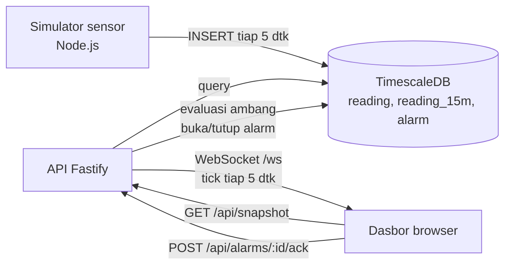

# 01 · Pusat Pemantauan Pabrik

Pratinjau konsep dasbor untuk klien: layar dinding ruang kontrol untuk supervisor shift. Satu layar
1920×1080 tanpa scroll menampilkan status 10 area pabrik selama 24 jam, alarm aktif, beban listrik, dan suhu
ruang produksi, diperbarui tiap 5 detik lewat WebSocket. Backend Docker adalah demo teknis opsional untuk
menunjukkan arsitektur yang diusulkan.

> Mockup untuk klien. Semua titik sensor, nama area, dan angka adalah **data contoh** dari simulator.

| | |
|---|---|
| Pengguna utama | Supervisor shift di ruang kontrol |
| Database | PostgreSQL 16 + TimescaleDB 2.17 (hypertable, continuous aggregate 15 menit, retensi) |
| Cara menarik data | REST untuk snapshot awal, lalu WebSocket push tiap 5 detik |
| Backend | Node.js 22 + Fastify 5 (`@fastify/websocket`, `pg`) |
| Dasbor | http://localhost:18010 |
| Pratinjau tanpa Docker | `web/index.html?pratinjau` |
| Status | Pratinjau konsep (mockup), bukan sistem produksi. Backend demo diuji 5 November 2026. |

## Arsitektur



Alur data:

1. Simulator (di produksi: gateway lapangan) menulis 17 titik sensor tiap 5 detik ke hypertable `reading`
   dan mengisi riwayat 24 jam saat start.
2. Continuous aggregate `reading_15m` merangkum per 15 menit untuk pita status dan grafik 24 jam.
3. API mengevaluasi nilai terbaru tiap 5 detik terhadap ambang di tabel `sensor`, membuka atau menutup
   baris di tabel `alarm`, lalu mendorong hasilnya ke semua klien WebSocket.
4. Dasbor (HTML, CSS, JavaScript tanpa framework; grafik dari `../shared/charts.js`) memuat snapshot
   sekali, menerima tick tiap 5 detik, dan memuat ulang snapshot tiap 60 detik untuk memperbarui pita
   dan grafik.

## Menjalankan

### Pratinjau tanpa instalasi

Buka `web/index.html?pratinjau` di peramban, atau galeri semua proyek di `../pratinjau.html`. Dasbor
memakai data contoh bawaan. Tanpa `?pratinjau`, dasbor yang dibuka dari berkas menampilkan pita
"Mode data contoh".

### Demo teknis dengan Docker (opsional)

Prasyarat: Docker Desktop (Compose v2).

```bash
cp .env.example .env        # lalu ganti PGPASSWORD
docker compose up -d --build
```

Buka http://localhost:18010. Menghentikan: `docker compose stop`. Menghapus data contoh juga:
`docker compose down -v`.

## Konfigurasi

| Alamat | Isi |
|---|---|
| http://localhost:18010 | Dasbor |
| http://localhost:18010/api/snapshot | Snapshot JSON |
| ws://localhost:18010/ws | Aliran tick |
| `127.0.0.1:18011` | PostgreSQL (hanya dari komputer ini) |

| Variabel | Bawaan | Arti |
|---|---|---|
| `PGDATABASE`, `PGUSER`, `PGPASSWORD` | lihat `.env.example` | Kredensial database (wajib diisi) |
| `TZ_OFFSET_MIN` | `420` | Zona waktu pabrik dalam menit dari UTC (WIB) |
| `SHIFT_STARTS` | `06:00,14:00,22:00` | Jam mulai shift, `[REAL DATA: jadwal shift pabrik]` |

Ambang alarm per sensor ada di tabel `sensor` (lihat `docs/DAFTAR-TITIK.md`) dan bisa diubah dengan SQL
tanpa memulai ulang API.

## Struktur folder

```
api/            server.js (REST + WebSocket + evaluasi alarm), Dockerfile, package.json
simulator/      sim.js (pembangkit data contoh)
db/init.sql     skema, kebijakan TimescaleDB, data titik sensor
web/            index.html, style.css, app.js
docs/           API.md, DATABASE.md, DAFTAR-TITIK.md, DESAIN.md
```

## Keamanan

- Kredensial database hanya lewat `.env` (`.env.example` tanpa kata sandi asli; `.env` tidak di-commit).
- PostgreSQL hanya terbuka di `127.0.0.1:18011`; dasbor dan API disajikan dari satu origin, jadi CORS
  tidak dibuka.
- `id` pada `POST /api/alarms/:id/ack` divalidasi skema Fastify (selain bilangan bulat ≥ 1 dijawab 400).
- Demo tidak memakai autentikasi (lihat batasan).

## Pengujian dan verifikasi

Verifikasi 5 November 2026:

- `docker compose up -d --build`: ketiga layanan berjalan, simulator mengisi riwayat 1.440 menit.
- `GET /api/health` → `{"ok":true}`; `GET /api/snapshot` mengembalikan 10 area × 96 sel, 2 sampai 3 alarm
  aktif (oven Line 2 kritis, getaran K-02, pintu cold storage sesuai siklus), 16 dari 17 sensor online
  (TH-GD-08 sengaja offline).
- Dasbor dirender di 1920×1080 lewat Edge headless dengan koneksi WebSocket hidup.
- Lint desain (`sloplint`): 0 FAIL. Kontras teks utama ≥ 5,3:1.

## Batasan dan langkah berikutnya

Proyek ini adalah pratinjau konsep. Autentikasi, skala, backup, dan pemantauan produksi berada di luar
cakupan pratinjau dan perlu dirancang bila klien memilih proyek ini untuk dilanjutkan. Hal yang perlu
diperhatikan pada tahap itu:

- Evaluasi alarm di demo berjalan di satu instans API. Untuk lebih dari satu instans, pindahkan ke proses
  tersendiri atau kunci dengan `pg_advisory_lock`.
- Login (mis. SSO pabrik) supaya hanya petugas berwenang yang bisa mengakui alarm; di demo siapa pun di
  jaringan bisa melakukannya.
- Titik sensor, ambang, dan jadwal shift adalah contoh; ganti dengan daftar titik asli dari klien.

## Dokumentasi terkait

- [docs/API.md](docs/API.md): endpoint REST dan pesan WebSocket, dengan contoh permintaan dan jawaban.
- [docs/DATABASE.md](docs/DATABASE.md): skema, hypertable, continuous aggregate, dan retensi.
- [docs/DAFTAR-TITIK.md](docs/DAFTAR-TITIK.md): daftar titik sensor beserta satuan dan ambang alarm.
- [docs/DESAIN.md](docs/DESAIN.md): arah desain dan token warna serta huruf.
