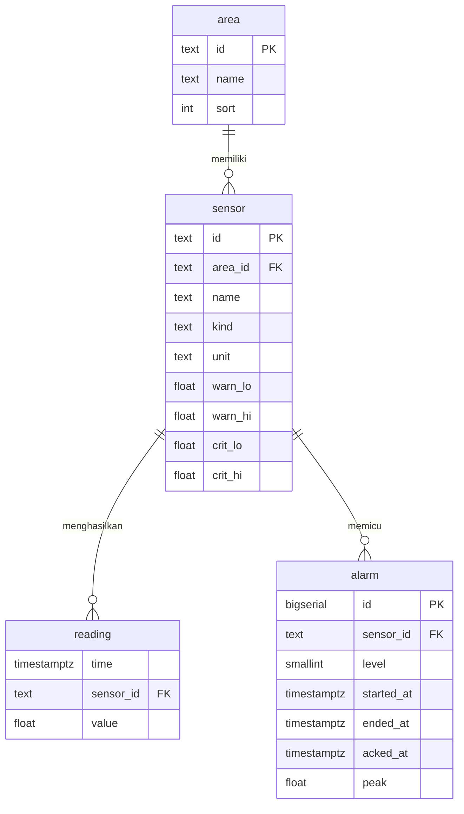

# Database · Pusat Pemantauan Pabrik

PostgreSQL 16 dengan ekstensi TimescaleDB 2.17. Skema lengkap: `db/init.sql` (dijalankan otomatis saat
volume database masih kosong).

## Model data

| Tabel | Jenis | Isi |
|---|---|---|
| `area` | biasa | 10 area pabrik dan urutan tampil |
| `sensor` | biasa | Titik sensor, satuan, dan ambang peringatan/kritis (NULL = tidak ada batas di sisi itu) |
| `reading` | **hypertable**, partisi 1 hari | Pembacaan mentah, satu baris per sensor per pembacaan |
| `reading_15m` | **continuous aggregate** | `avg`, `min`, `max`, `n` per sensor per 15 menit |
| `alarm` | biasa | Kejadian alarm; paling banyak satu alarm terbuka per sensor |

## Indeks dan batasan

| Objek | Tujuan |
|---|---|
| `reading_sensor_time (sensor_id, time DESC)` | Nilai terbaru per sensor (`LATERAL … LIMIT 1`) |
| `alarm_one_open` unik parsial `WHERE ended_at IS NULL` | Menjamin satu alarm terbuka per sensor; dipakai `ON CONFLICT` |
| `alarm_started (started_at DESC)` | Riwayat alarm terbaru |
| `CHECK` pada `sensor` | Ambang peringatan tidak melewati ambang kritis |
| `CHECK (level IN (1, 2))` | Tingkat alarm hanya peringatan atau kritis |

## Kebijakan TimescaleDB

| Kebijakan | Nilai | Alasan |
|---|---|---|
| Retensi `reading` | 30 hari | Data mentah 5 detik hanya perlu untuk investigasi jangka pendek |
| Refresh `reading_15m` | tiap 5 menit, jendela 3 hari sampai 15 menit lalu | Pita status dan grafik tidak perlu lebih segar dari 5 menit; periode berjalan dihitung langsung (`materialized_only = false`) |
| Retensi `reading_15m` | 400 hari | Cukup untuk perbandingan tahunan |

## Perkiraan ukuran

17 sensor × 1 pembacaan per 5 detik = 293.760 baris per hari. Dengan sekitar 50 byte per baris (sebelum
kompresi), data mentah 30 hari ≈ 440 MB. Agregat 15 menit: 17 × 96 × 400 hari ≈ 650 ribu baris (< 100 MB).
Untuk ratusan sensor, aktifkan kompresi hypertable (`add_compression_policy`, segmentby `sensor_id`).

## Kueri utama

- **Status area 24 jam**: gabungkan `reading_15m` dengan ambang `sensor`, ambil tingkat terburuk per area
  per periode; periode dengan sensor yang tidak melapor ditandai sebagian offline.
- **Alarm**: `INSERT … ON CONFLICT (sensor_id) WHERE ended_at IS NULL DO UPDATE` membuka atau memperbarui
  alarm; `UPDATE … SET ended_at = now()` menutupnya saat nilai kembali normal. Waktu mulai diambil dari
  pembacaan pertama setelah nilai normal terakhir.

## Cadangan

`docker compose exec db pg_dump -U $PGUSER -Fc $PGDATABASE > cadangan.dump`. Untuk TimescaleDB, pulihkan
dengan `timescaledb_pre_restore()` dan `timescaledb_post_restore()` sesuai panduan Timescale.
