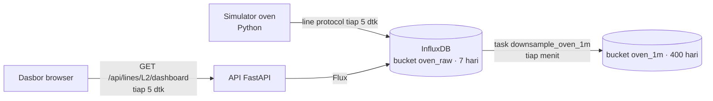

# 02 · Monitor Oven Reflow SMT

Pratinjau konsep dasbor untuk klien: alat kerja insinyur proses untuk memastikan profil suhu oven
reflow dua lini SMT sesuai resep. Isinya suhu aktual dibanding setpoint di 10 zona, profil termal papan uji,
kadar O₂, kecepatan konveyor, dan tren zona yang paling menyimpang; dasbor menarik data tiap 5 detik.
Backend Docker adalah demo teknis opsional untuk menunjukkan arsitektur yang diusulkan.

> Mockup untuk klien. Semua angka adalah **data contoh** dari simulator. Nama resep dan target profil
> perlu diisi dari klien.

| | |
|---|---|
| Pengguna utama | Insinyur proses SMT |
| Database | InfluxDB 2.7 (bucket mentah 7 hari + bucket downsampling 1 menit 400 hari, task Flux) |
| Cara menarik data | REST polling tiap 5 detik; query Flux dijalankan di server |
| Backend | Python 3.12 + FastAPI + `influxdb-client` |
| Dasbor | http://localhost:18020 |
| Pratinjau tanpa Docker | `web/index.html?pratinjau` |
| Status | Pratinjau konsep (mockup), bukan sistem produksi. Backend demo diuji 5 November 2026. |

## Arsitektur



Simulator Python menulis 2 lini × 10 zona tiap 5 detik, data papan uji tiap 10 menit, dan mengisi riwayat
24 jam saat start. Satu permintaan `dashboard` mengembalikan semua yang dibutuhkan satu layar, jadi
polling 5 detik cukup satu request per klien. Dasbor memakai HTML, CSS, dan JavaScript tanpa framework,
dengan grafik dari `../shared/charts.js`.

## Menjalankan

### Pratinjau tanpa instalasi

Buka `web/index.html?pratinjau` di peramban, atau galeri semua proyek di `../pratinjau.html`. Dasbor
memakai data contoh bawaan. Tanpa `?pratinjau`, dasbor yang dibuka dari berkas menampilkan pita
"Mode data contoh".

### Demo teknis dengan Docker (opsional)

```bash
cp .env.example .env        # ganti INFLUX_ADMIN_PASSWORD dan INFLUX_TOKEN
docker compose up -d --build
```

Buka http://localhost:18020. Menghentikan: `docker compose stop`.

## Konfigurasi

| Alamat | Isi |
|---|---|
| http://localhost:18020 | Dasbor |
| http://localhost:18020/docs | Dokumentasi OpenAPI otomatis (FastAPI) |
| http://localhost:18020/api/lines/L2/dashboard | Data satu layar |
| http://127.0.0.1:18021 | Antarmuka InfluxDB (hanya dari komputer ini) |

| Variabel | Bawaan | Arti |
|---|---|---|
| `INFLUX_ADMIN_USER`, `INFLUX_ADMIN_PASSWORD` | lihat `.env.example` | Akun admin awal InfluxDB |
| `INFLUX_ORG`, `INFLUX_BUCKET` | `konsep`, `oven_raw` | Organisasi dan bucket mentah |
| `INFLUX_TOKEN` | wajib diisi | Token admin (uji). Produksi: token baca untuk API, token tulis untuk gateway |
| `ZONE_TOLERANCE_C` | `3` | Toleransi selisih aktual dan setpoint (°C) |
| `RECIPE_L1`, `RECIPE_L2` | `[REAL DATA: …]` | Nama resep aktif per lini |
| `TZ_OFFSET_MIN` | `420` | Zona waktu untuk hitungan papan per shift (WIB) |

## Struktur folder

```
api/            main.py (FastAPI), requirements.txt, Dockerfile (dipakai juga oleh simulator)
simulator/      sim.py
db/             influx-init.sh (bucket + task), downsample_oven_1m.flux
web/            index.html, style.css, app.js
docs/           API.md, DATABASE.md, DAFTAR-TITIK.md, DESAIN.md
```

## Keamanan

- Token InfluxDB hanya ada di API dan simulator; browser tidak pernah menerima token atau menulis Flux.
- Kredensial lewat `.env`; antarmuka InfluxDB hanya terbuka di `127.0.0.1:18021`.
- Dasbor dan API satu origin, jadi CORS tidak dibuka. Parameter lini, zona, dan rentang divalidasi
  FastAPI (nilai di luar daftar dijawab 422).
- Demo tidak memakai autentikasi (lihat batasan).

## Pengujian dan verifikasi

Verifikasi 5 November 2026:

- `docker compose up -d --build`: InfluxDB sehat, bucket `oven_raw` (168 jam) dan `oven_1m` (9.600 jam)
  serta task `downsample_oven_1m` aktif; simulator mengisi riwayat 24 jam.
- `GET /api/lines/L2/dashboard`: Z6 kritis (+7,2 °C, pemanas 100 %), konveyor 0,75 m/mnt, profil papan
  60 titik (puncak 249,1 °C, 65 detik di atas likuidus), tren 2 jam 121 titik.
- Validasi: `/api/lines/L3/dashboard` → 422; `/zones/Z11/trend` → 422.
- Dasbor dirender di 1920×1080 lewat Edge headless. Lint desain: 0 FAIL. Kontras teks ≥ 5,2:1.

## Batasan dan langkah berikutnya

Proyek ini adalah pratinjau konsep. Autentikasi, skala, backup, dan pemantauan produksi berada di luar
cakupan pratinjau dan perlu dirancang bila klien memilih proyek ini untuk dilanjutkan. Hal yang perlu
diperhatikan pada tahap itu:

- Login, atau penempatan khusus di jaringan pabrik; demo tidak memakai autentikasi.
- Data mentah 24 jam pertama hanya ada di `oven_raw`; `oven_1m` terisi mulai saat task berjalan.
  Query di atas 7 hari perlu diarahkan ke `oven_1m` (belum dipakai dasbor).
- Target profil (waktu di atas likuidus, suhu puncak) di dasbor adalah contoh; ambil dari lembar data
  pasta solder yang dipakai klien.

## Dokumentasi terkait

- [docs/API.md](docs/API.md): endpoint REST, parameter, dan contoh jawaban.
- [docs/DATABASE.md](docs/DATABASE.md): bucket, measurement, task downsampling, dan retensi InfluxDB.
- [docs/DAFTAR-TITIK.md](docs/DAFTAR-TITIK.md): daftar titik sensor oven beserta satuan dan ambang.
- [docs/DESAIN.md](docs/DESAIN.md): arah desain dan token warna serta huruf.
