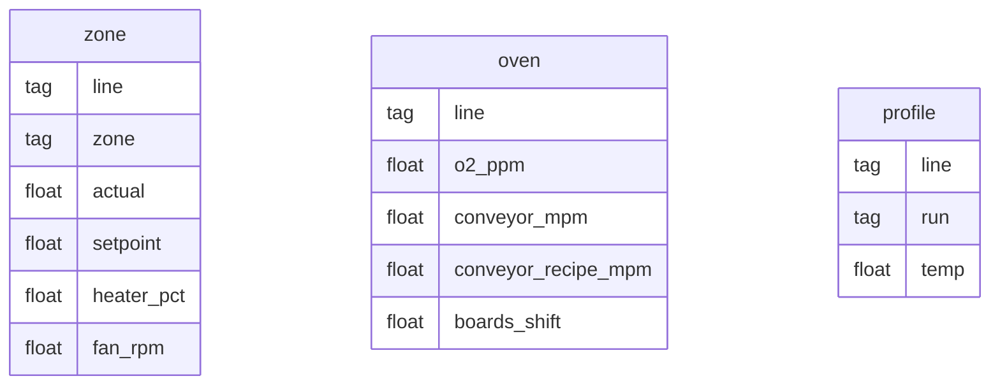

# Database · Monitor Oven Reflow SMT

InfluxDB 2.7. Setup awal lewat variabel `DOCKER_INFLUXDB_INIT_*` di `docker-compose.yml`, lalu
`db/influx-init.sh` membuat bucket downsampling dan task.

## Bucket dan retensi

| Bucket | Retensi | Isi |
|---|---|---|
| `oven_raw` | 7 hari | Data mentah 5 detik dan profil papan uji |
| `oven_1m` | 400 hari | Rata-rata 1 menit measurement `zone` dan `oven`, diisi task |

## Model data (measurement, tag, field)

InfluxDB tidak punya relasi; kunci seri = measurement + set tag.



| Measurement | Tag | Field | Frekuensi |
|---|---|---|---|
| `zone` | `line` (L1, L2), `zone` (Z1 sampai Z10) | `actual` °C, `setpoint` °C, `heater_pct` %, `fan_rpm` | 5 detik |
| `oven` | `line` | `o2_ppm`, `conveyor_mpm`, `conveyor_recipe_mpm`, `boards_shift` | 5 detik |
| `profile` | `line`, `run` (YYYYMMDDHHMM UTC) | `temp` °C (suhu papan dari termokopel probe) | 60 titik per 5 detik, tiap 10 menit |

Kardinalitas seri: zone 2 × 10 × 4 field = 80, oven 2 × 4 = 8, profile 2 × 144 run per hari (bertambah,
terbatas retensi 7 hari ≈ 2.000 seri). Aman untuk satu node InfluxDB.

Semua field bertipe float, termasuk `boards_shift`, agar `pivot` setelah `group()` tidak bertabrakan tipe.

## Task downsampling

`db/downsample_oven_1m.flux`:

```flux
option task = {name: "downsample_oven_1m", every: 1m, offset: 15s}
from(bucket: "oven_raw")
    |> range(start: -task.every)
    |> filter(fn: (r) => r._measurement == "zone" or r._measurement == "oven")
    |> aggregateWindow(every: 1m, fn: mean, createEmpty: false)
    |> to(bucket: "oven_1m")
```

`offset: 15s` memberi waktu bagi titik yang datang terlambat sebelum menit dirangkum.

## Perkiraan ukuran

Sekitar 22 titik × 5 field tiap 5 detik ≈ 1,9 juta nilai per hari mentah. Dengan kompresi TSM InfluxDB
(umumnya beberapa byte per nilai) data 7 hari berada di kisaran ratusan MB. Bucket 1 menit sekitar
1/12 dari itu per hari.

## Cadangan

`docker compose exec influxdb influx backup /tmp/cadangan -t $INFLUX_TOKEN`, lalu salin folder keluar
kontainer dengan `docker compose cp`.
