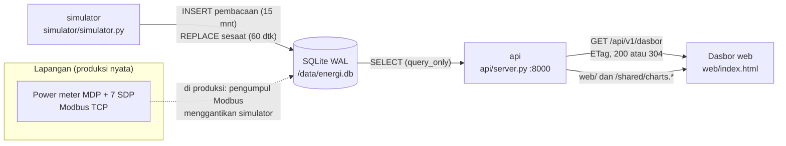

# 03 · Pemantauan Energi Listrik

Pratinjau konsep dasbor untuk klien, ditujukan bagi manajer fasilitas yang harus menjaga beban
listrik pabrik tetap di bawah batas daya kontrak PLN. Backend Docker adalah demo teknis opsional untuk
menunjukkan arsitektur yang diusulkan. Layar ini menjawab satu pertanyaan: **berapa sisa kapasitas sampai batas kontrak hari ini, dan siapa
penyebab puncaknya?** Angka sisa kapasitas tampil besar di kiri, grafik beban 24 jam dengan garis batas
kontrak di kanan, lalu energi per jam, pemakaian per area, dan kualitas daya per panel.

> Semua angka adalah data contoh dari simulator. Tarif, alamat meter, dan merek meter diisi dari data klien
> (`[REAL DATA: ...]`).

| | |
|---|---|
| Pengguna utama | Manajer fasilitas |
| Database | SQLite 3 (mode WAL), satu file `energi.db` di volume `energi-data` |
| Cara menarik data | REST + ETag / `If-None-Match`: `/api/v1/dasbor` tiap 60 detik, jawaban `304` bila data tidak berubah |
| Backend | Python 3.13, pustaka standar saja (`http.server` + `sqlite3`) |
| Dasbor | http://localhost:18030 |
| Pratinjau tanpa Docker | `web/index.html?pratinjau` |
| Status | Pratinjau konsep (mockup), bukan sistem produksi. Backend demo diuji 5 November 2026. |

## Arsitektur



Simulator (Python 3.13, pustaka standar) menghasilkan data 8 power meter dengan interval 15 menit dan nilai
sesaat. Simulator dan API berbagi satu volume. SQLite WAL mengizinkan satu penulis dan banyak pembaca
bersamaan, cukup untuk satu pabrik (8 meter × 96 interval per hari). Di produksi, simulator diganti
pengumpul Modbus yang menulis ke tabel yang sama; API dan dasbor tidak berubah. Frontend memakai HTML, CSS,
dan JavaScript tanpa framework, dengan grafik dari `../shared/charts.js`.

## Menjalankan

### Pratinjau tanpa instalasi

Buka `web/index.html?pratinjau` di peramban, atau galeri semua proyek di `../pratinjau.html`. Dasbor
memakai data contoh bawaan. Tanpa `?pratinjau`, dasbor yang dibuka dari berkas menampilkan pita
"Mode data contoh: API tidak terhubung".

### Demo teknis dengan Docker (opsional)

Prasyarat: Docker Desktop (atau Docker Engine + Compose v2).

```bash
cd 03-energi-listrik
cp .env.example .env            # opsional, untuk mengubah port atau interval
docker compose -p konsep-03 up -d --build
```

Buka **http://localhost:18030**. Saat pertama start, simulator mengisi riwayat 8 hari (sekitar 6.000 baris)
sehingga grafik langsung penuh.

Menghentikan: `docker compose -p konsep-03 stop`. Data tetap tersimpan di volume `konsep-03_energi-data`.

Backend demo juga bisa dijalankan tanpa Docker (Python 3.11 ke atas):

```bash
DB_PATH=./energi.db python simulator/simulator.py &
DB_PATH=./energi.db PORT=18030 python api/server.py
```

## Konfigurasi

| Port host | Layanan |
|---|---|
| 18030 | api + dasbor (satu server) |
| 18031 sampai 18039 | dicadangkan |

| Variabel | Bawaan | Arti |
|---|---|---|
| `PORT_DASBOR` | 18030 | port host untuk dasbor dan API |
| `SESAAT_DETIK` | 60 | interval simulator memperbarui nilai sesaat |
| `RIWAYAT_HARI` | 8 | panjang riwayat yang diisi saat database kosong |
| `DB_PATH` | `/data/energi.db` | lokasi file SQLite (di dalam container) |

## Struktur folder

```
03-energi-listrik/
  api/server.py          REST API + penyaji file statis
  api/uji.py             uji otomatis API (tanpa Docker)
  simulator/simulator.py pembangkit data power meter
  db/skema.sql           skema, konfigurasi ambang, master panel & meter
  web/                   dasbor (index.html, style.css, app.js)
  docs/API.md            spesifikasi endpoint dan contoh jawaban
  docs/DATABASE.md       model data, indeks, retensi, ukuran
  docs/DAFTAR-TITIK.md   daftar titik ukur (point list)
  docs/DESAIN.md         arah desain dan token
```

## Keamanan

- API membuka SQLite dalam mode `query_only`; hanya simulator yang menulis.
- Parameter divalidasi (nilai salah dijawab `400`, endpoint tak dikenal `404`), dan penyaji file statis
  menolak path di luar `web/` dan `/shared/charts.*`.
- Tidak ada kredensial di kode; konfigurasi lewat `.env`.
- Demo tidak memakai autentikasi dan ditujukan untuk jaringan internal (lihat batasan).

## Pengujian dan verifikasi

```bash
python api/uji.py
```

Uji ini membuat database sementara, mengisi 2 hari data, lalu memeriksa bentuk jawaban `/api/v1/dasbor`,
perhitungan sisa kapasitas, deteksi faktor daya rendah dan arus tidak seimbang, jawaban `304` untuk ETag
yang sama, validasi parameter (`400`), endpoint tak dikenal (`404`), dan penolakan path di luar
`/shared/charts.*`.

Verifikasi 5 November 2026:

- `python api/uji.py` → `uji API 03: semua lulus`.
- `docker compose -p konsep-03 up -d --build` → `simulator: backfill 768 interval`.
- `curl -i http://localhost:18030/api/v1/ringkasan` → `200` dengan header `ETag`.
- `curl -H 'If-None-Match: <etag>' http://localhost:18030/api/v1/dasbor` → `304`.
- `curl http://localhost:18030/api/v1/beban?jam=500` → `400 {"galat": "Parameter jam harus bilangan bulat 1 sampai 192."}`.
- Dasbor dirender di Edge headless 1920×1080 dalam mode terhubung dan mode data contoh (`file://`).
- `sloplint`: 0 FAIL. Kontras teks utama ≥ 5,4:1.

## Batasan dan langkah berikutnya

Proyek ini adalah pratinjau konsep. Autentikasi, skala, backup, dan pemantauan produksi berada di luar
cakupan pratinjau dan perlu dirancang bila klien memilih proyek ini untuk dilanjutkan. Hal yang perlu
diperhatikan pada tahap itu:

- Reverse proxy dengan login (mis. SSO perusahaan) bila API dibuka di luar jaringan OT; demo tidak
  memakai autentikasi.
- Perhitungan biaya energi, setelah tarif LWBP/WBP kontrak klien tersedia (`[REAL DATA]`).
- Energi hari ini dihitung sampai interval 15 menit terakhir yang lengkap.
- SQLite cukup untuk satu lokasi. Untuk banyak pabrik atau resolusi 1 detik, pindahkan `pembacaan` ke
  basis data deret waktu.

## Dokumentasi terkait

- [docs/API.md](docs/API.md): spesifikasi endpoint, ETag, dan contoh jawaban.
- [docs/DATABASE.md](docs/DATABASE.md): model data, indeks, retensi, dan perkiraan ukuran.
- [docs/DAFTAR-TITIK.md](docs/DAFTAR-TITIK.md): daftar titik ukur power meter.
- [docs/DESAIN.md](docs/DESAIN.md): arah desain dan token warna serta huruf.
