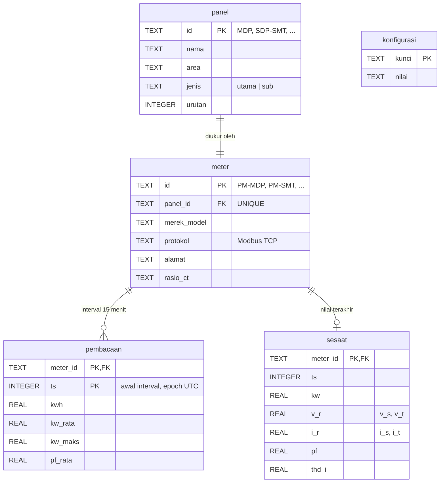

# Database · Pemantauan Energi Listrik

SQLite 3 dalam mode WAL, satu file `/data/energi.db` di volume Docker `energi-data`. Skema lengkap dan data
master ada di [`db/skema.sql`](../db/skema.sql); api dan simulator menjalankannya secara idempoten saat start.

## Mengapa SQLite

- Data per pabrik kecil: 8 meter × 96 interval per hari ≈ 280.000 baris per tahun.
- Tanpa server database terpisah: cadangan cukup dengan menyalin satu file (`sqlite3 energi.db ".backup cadangan.db"`).
- WAL mengizinkan pengumpul data menulis sementara API membaca, tanpa saling mengunci.
- Pustaka `sqlite3` sudah ada di Python, jadi backend tetap tanpa dependensi.

## Diagram relasi



## Tabel

| Tabel | Isi | Penulis | Pembaca |
|---|---|---|---|
| `konfigurasi` | batas kontrak dan ambang kualitas daya | admin (SQL) | api |
| `panel` | master panel distribusi; `jenis='utama'` hanya MDP | admin | api |
| `meter` | master power meter, satu per panel | admin | api |
| `pembacaan` | satu baris per meter per interval 15 menit yang sudah lengkap | simulator / pengumpul | api |
| `sesaat` | nilai sesaat terakhir per meter, ditimpa tiap siklus | simulator / pengumpul | api |

### Aturan data

- `ts` selalu epoch UTC kelipatan 900 dan menandai **awal** interval. Konversi ke WIB (UTC+7) dilakukan
  API; Indonesia tidak memakai waktu musim panas, jadi selisihnya tetap.
- `kwh` = energi aktif selama interval (selisih register kWh meter); `kw_rata = kwh / 0,25`.
- `kw_maks` = demand maksimum dalam interval, dipakai untuk "puncak hari ini".
- MDP diukur langsung, bukan dijumlahkan dari SDP; selisihnya mencerminkan rugi distribusi dan beban
  yang belum diberi meter.
- Penyisipan memakai `INSERT OR IGNORE`, sehingga pengiriman ulang interval yang sama aman (idempoten).

### Konfigurasi bawaan

| kunci | nilai | arti |
|---|---|---|
| `batas_kontrak_kw` | 1600 | daya kontrak, `[REAL DATA: dari kontrak PLN klien]` |
| `pf_min` | 0.85 | di bawah ini dasbor memberi peringatan faktor daya rendah |
| `ketidakseimbangan_maks_persen` | 10 | ambang peringatan arus tidak seimbang |
| `thd_i_maks_persen` | 15 | ambang peringatan THD arus |

## Indeks

| Indeks | Kolom | Untuk |
|---|---|---|
| PK `pembacaan` (WITHOUT ROWID) | `meter_id, ts` | deret per meter (`/beban`), penyisipan idempoten |
| `ix_pembacaan_ts` | `ts` | agregasi lintas meter per hari (`/area`, penyumbang puncak) |

## Retensi dan ukuran

| Data | Laju | Per tahun |
|---|---|---|
| `pembacaan` | 8 × 96 baris per hari | ≈ 280.000 baris, ≈ 20 MB |
| `sesaat` | 8 baris tetap | < 1 MB |

Belum ada pemangkasan otomatis; 5 tahun data masih di bawah 150 MB. Bila perlu:

```sql
DELETE FROM pembacaan WHERE ts < strftime('%s', 'now', '-5 years');
VACUUM;
```

## Cadangan

```bash
docker compose -p konsep-03 exec api python -c "import sqlite3; s=sqlite3.connect('/data/energi.db'); d=sqlite3.connect('/data/cadangan.db'); s.backup(d)"
docker cp konsep-03-api-1:/data/cadangan.db ./cadangan-energi.db
```
