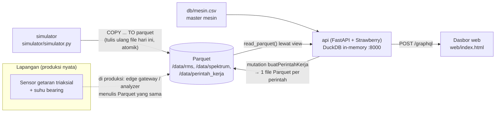

# 04 · Perawatan Prediktif Getaran

Pratinjau konsep dasbor untuk klien: alat bantu teknisi perawatan memutuskan **mesin mana yang
harus diperiksa lebih dulu, dan kenapa**. Sidebar mengurutkan mesin dari yang paling perlu tindakan; panel
kanan menampilkan getaran terkini dan zona ISO 10816-1, spektrum frekuensi dengan penanda cacat bearing
(BPFO), tren 30 hari, serta perintah kerja. Backend Docker adalah demo teknis opsional untuk menunjukkan
arsitektur yang diusulkan.

> Semua angka adalah data contoh dari simulator. Tipe bearing, faktor BPFO, dan jam operasi diisi dari data
> klien atau CMMS (`[REAL DATA: ...]`).

| | |
|---|---|
| Pengguna utama | Teknisi perawatan |
| Database | DuckDB 2.0 + file Parquet (Parquet per hari di volume `getaran-data`; DuckDB in-memory sebagai mesin kueri) |
| Cara menarik data | GraphQL (`POST /graphql`), termasuk mutation untuk perintah kerja |
| Backend | Python 3.13, FastAPI 0.162, Strawberry 0.339, Uvicorn |
| Dasbor | http://localhost:18040 |
| Pratinjau tanpa Docker | `web/index.html?pratinjau` |
| Status | Pratinjau konsep (mockup), bukan sistem produksi. Backend demo diuji 5 November 2026. |

## Arsitektur



Simulator (Python 3.13 + DuckDB) menghasilkan data 7 mesin: RMS tiap 10 menit dan spektrum 200 garis tiap
jam. Parquet dipilih karena data getaran bersifat tambah-saja dan dianalisis secara kolom (rata-rata harian,
spektrum terakhir). Penulis dan pembaca tidak saling mengunci: simulator menulis file baru lalu
menggantinya secara atomik (`os.replace`), API selalu membaca file utuh. Dasbor meminta tepat field yang
dibutuhkan; grafik dari `../shared/charts.js`, spektrum digambar khusus.

## Menjalankan

### Pratinjau tanpa instalasi

Buka `web/index.html?pratinjau` di peramban, atau galeri semua proyek di `../pratinjau.html`. Dasbor
memakai data contoh bawaan; formulir perintah kerja nonaktif karena tidak ada API.

### Demo teknis dengan Docker (opsional)

```bash
cd 04-getaran-prediktif
cp .env.example .env            # opsional
docker compose -p konsep-04 up -d --build
```

- Dasbor: **http://localhost:18040**
- GraphiQL (eksplorasi skema): **http://localhost:18040/graphql**
- Kesehatan: `curl http://localhost:18040/kesehatan`

Saat start, simulator menulis riwayat 30 hari (sekitar 6 detik). Menghentikan:
`docker compose -p konsep-04 stop`. Data tetap di volume `konsep-04_getaran-data`.

## Konfigurasi

| Port host | Layanan |
|---|---|
| 18040 | api + dasbor + GraphiQL |
| 18041 sampai 18049 | dicadangkan |

| Variabel | Bawaan | Arti |
|---|---|---|
| `PORT_DASBOR` | 18040 | port host |
| `UKUR_MENIT` | 10 | interval pengukuran RMS simulator |
| `RIWAYAT_HARI` | 30 | panjang riwayat yang ditulis saat start |
| `OFFLINE_MENIT` | 30 | mesin dianggap offline bila pengukuran terakhir lebih tua dari ini |
| `GRAPHIQL` | 1 | `1` = GraphiQL aktif; set `0` di luar demo |

## Struktur folder

```
04-getaran-prediktif/
  api/app.py             skema GraphQL, resolver DuckDB, penyaji statis
  api/schema.graphql     skema hasil ekspor (SDL), untuk klien dan review
  api/uji.py             uji otomatis skema GraphQL
  simulator/simulator.py pembangkit RMS dan spektrum
  db/mesin.csv           master mesin (dapat diedit klien)
  db/model.sql           view DuckDB di atas file Parquet
  web/                   dasbor
  docs/API.md            kueri, mutation, contoh jawaban, galat
  docs/DATABASE.md       tata letak file, skema kolom, retensi
  docs/DAFTAR-TITIK.md   daftar titik ukur per mesin
  docs/DESAIN.md         arah desain dan token
```

## Keamanan

- `QueryDepthLimiter(max_depth=6)` dan `MaxAliasesLimiter(15)` menolak kueri yang terlalu dalam atau
  terlalu banyak alias.
- Argumen divalidasi (mis. `tren(hari: 0)` ditolak, judul perintah kerja 3 sampai 120 karakter, mesin tak
  dikenal ditolak).
- Dasbor dan API satu origin; tidak ada header CORS. GraphiQL bisa dimatikan dengan `GRAPHIQL=0`.
- Demo tidak memakai autentikasi (lihat batasan).

## Pengujian dan verifikasi

```bash
docker compose -p konsep-04 run --rm --no-deps api python api/uji.py
```

Uji ini menulis data simulator ke folder sementara lalu memeriksa: batas zona ISO kelas I dan II, urutan
daftar mesin (K-02 paling atas), status offline CV-TV, puncak spektrum tertinggi K-02 berada di BPFO,
ringkasan, mutation (judul dirapikan, mesin tak dikenal ditolak), dan validasi argumen `tren(hari: 0)`.

Verifikasi 5 November 2026:

- `api/uji.py` → `uji GraphQL 04: semua lulus`.
- `docker compose -p konsep-04 up -d --build` → `simulator: riwayat 30 hari ditulis dalam 6.2 dtk`.
- `curl -X POST /graphql` `{ ringkasan { jumlahMesin perluTindakan offline } }` → `7, 1, 1`.
- Mutation `buatPerintahKerja` untuk K-02 → `PK-97E9360C`, status `DIBUKA`, muncul di `mesin { perintahKerja }`.
- Mutation dengan judul 1 karakter → galat "Judul perintah kerja harus 3 sampai 120 karakter."
- Dasbor dirender di Edge headless 1920×1080 dalam mode terhubung (K-02 dan CV-TV offline) dan mode data
  contoh (`file://`).
- `sloplint`: 0 FAIL. Kontras teks meta 4,8:1 sampai 5,9:1 di semua permukaan gelap.

## Batasan dan langkah berikutnya

Proyek ini adalah pratinjau konsep. Autentikasi, skala, backup, dan pemantauan produksi berada di luar
cakupan pratinjau dan perlu dirancang bila klien memilih proyek ini untuk dilanjutkan. Hal yang perlu
diperhatikan pada tahap itu:

- Autentikasi di depan API dan pembatasan mutation ke peran teknisi atau supervisor.
- Integrasi perintah kerja ke CMMS klien `[REAL DATA: sistem CMMS]`; di pratinjau perintah kerja hanya
  dicatat (status `DIBUKA`).
- Faktor BPFO di `mesin.csv` adalah contoh. Hitung dari geometri bearing sebenarnya (jumlah bola, diameter
  bola, diameter pitch, sudut kontak).
- Zona ISO 10816-1 dipakai sebagai panduan umum. Untuk mesin dengan standar khusus (mis. pompa menurut
  ISO 10816-7), sesuaikan batas di `BATAS_ISO`.

## Dokumentasi terkait

- [docs/API.md](docs/API.md): kueri dan mutation GraphQL, contoh jawaban, dan galat.
- [docs/DATABASE.md](docs/DATABASE.md): tata letak file Parquet, skema kolom, dan retensi.
- [docs/DAFTAR-TITIK.md](docs/DAFTAR-TITIK.md): daftar titik ukur per mesin.
- [docs/DESAIN.md](docs/DESAIN.md): arah desain dan token warna serta huruf.
