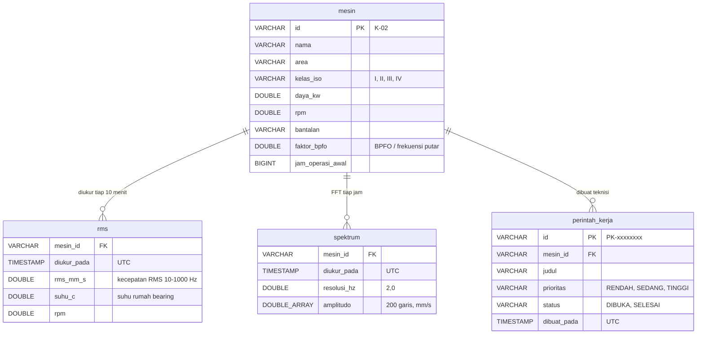

# Data · Perawatan Prediktif Getaran

Penyimpanan berupa **file Parquet** di volume `getaran-data` (`/data`) ditambah master mesin dalam CSV.
**DuckDB** berjalan in-memory di dalam API sebagai mesin kueri SQL di atas file tersebut; view-nya
didefinisikan di [`db/model.sql`](../db/model.sql).

## Mengapa DuckDB + Parquet

- Data getaran bersifat tambah-saja dan dibaca secara analitik (rata-rata harian, puncak spektrum), cocok
  untuk format kolom.
- Spektrum disimpan sebagai satu kolom daftar (`DOUBLE[]`) per pengukuran; Parquet mengompresnya dengan
  baik dan DuckDB membacanya tanpa konversi.
- Tidak ada server database: file bisa disalin, diarsipkan ke penyimpanan objek, atau dibuka analis dengan
  DuckDB, Python, maupun Power BI.
- Penulis (simulator/gateway) dan pembaca (API) tidak saling mengunci karena setiap file ditulis utuh lalu
  diganti secara atomik.

## Tata letak file

```
/data/
  rms/tgl=2026-11-05.parquet          RMS & suhu, satu file per hari (UTC), ditulis ulang tiap pengukuran
  spektrum/tgl=2026-11-05.parquet     spektrum per jam, 2 hari terakhir
  perintah_kerja/PK-97E9360C.parquet  satu file per perintah kerja
db/mesin.csv                          master mesin (di image, dapat di-mount ulang)
```

## Model data



Kolom `rms_dasar`, `suhu_dasar`, dan `degradasi` di `mesin.csv` hanya dipakai simulator untuk skenario data
contoh; pengumpul data nyata mengabaikannya.

## View DuckDB

| View | Isi |
|---|---|
| `mesin` | `read_csv('db/mesin.csv')` |
| `rms`, `spektrum`, `perintah_kerja` | `read_parquet('/data/<folder>/*.parquet')`; file baru otomatis ikut terbaca |
| `rms_harian` | rata-rata RMS dan suhu maksimum per mesin per tanggal WIB |
| `rms_terakhir` | pengukuran terakhir per mesin (`QUALIFY row_number() ... = 1`) |

View dibuat saat kueri pertama, sehingga API tetap bisa start sebelum simulator menulis file.

## Aturan data

- Semua waktu disimpan UTC tanpa zona (`TIMESTAMP`); API menambahkan `+00:00` dan dasbor menampilkan WIB.
- Zona ISO dihitung saat dibaca dari `rms_mm_s` dan `kelas_iso`, tidak disimpan, supaya perubahan batas
  tidak memerlukan migrasi data.
- Status `OFFLINE` dihitung dari umur `diukur_pada` terakhir (`OFFLINE_MENIT`).
- `faktor_bpfo` × `rpm/60` = frekuensi BPFO yang ditandai di spektrum.

## Ukuran dan retensi

| Data | Laju (7 mesin) | Perkiraan per tahun |
|---|---|---|
| `rms` | 7 × 144 baris per hari | ≈ 370.000 baris, ≈ 6 MB Parquet |
| `spektrum` | 7 × 24 × 200 nilai per hari | disimpan 2 hari (`SPEKTRUM_HARI`), ≈ 1 MB |
| `perintah_kerja` | sesuai pemakaian | < 1 MB |

Retensi RMS diatur dengan menghapus file harian lama (`rm /data/rms/tgl=2025-*.parquet`) atau
memindahkannya ke arsip. Untuk menyimpan riwayat spektrum lebih panjang, naikkan `SPEKTRUM_HARI`
(sekitar 0,5 MB per hari untuk 7 mesin).

## Membuka data secara manual

```bash
docker compose -p konsep-04 exec api python -c "import duckdb; print(duckdb.sql(\"SELECT mesin_id, round(avg(rms_mm_s),2) FROM read_parquet('/data/rms/*.parquet') GROUP BY 1 ORDER BY 2 DESC\"))"
```
