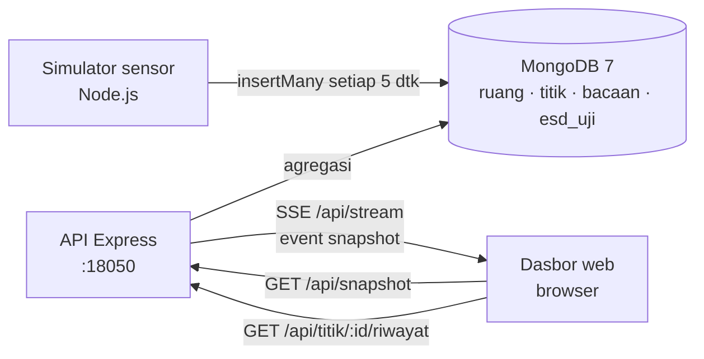

# 05 · Pemantauan Ruang Bersih & ESD

Pratinjau konsep dasbor untuk klien, dipakai petugas QC untuk memastikan setiap ruang produksi
memenuhi syarat suhu, kelembapan, partikel, dan beda tekanan, serta memantau kontrol ESD (ionizer dan uji
gelang ESD). Backend Docker adalah demo teknis opsional untuk menunjukkan arsitektur yang diusulkan.

> Semua angka adalah **data contoh** dari simulator.

| | |
|---|---|
| Pengguna utama | Petugas QC |
| Database | MongoDB 7 (koleksi master + time-series collection) |
| Cara menarik data | REST untuk snapshot dan riwayat, Server-Sent Events (SSE) untuk pembaruan setiap 5 detik |
| Backend | Node.js 20 + Express |
| Dasbor | http://localhost:18050 |
| Pratinjau tanpa Docker | `web/index.html?pratinjau` |
| Status | Pratinjau konsep (mockup), bukan sistem produksi. Backend demo diuji 5 November 2026. |

## Arsitektur



- Simulator Node.js menulis bacaan langsung ke MongoDB.
- API sekaligus menyajikan dasbor (`web/`) dan pustaka grafik bersama (`../shared`, di-mount baca saja).
  Frontend memakai HTML, CSS, dan JavaScript tanpa framework.
- Status (normal, peringatan, kritis, offline) dihitung di server (`api/status.js`), bukan di browser,
  supaya semua klien melihat hasil yang sama.
- Titik dianggap **offline** bila tidak ada bacaan lebih dari 2 menit.

## Menjalankan

### Pratinjau tanpa instalasi

Buka `web/index.html?pratinjau` di peramban, atau galeri semua proyek di `../pratinjau.html`. Dasbor
memakai `web/contoh.js` (snapshot hasil verifikasi). Tanpa `?pratinjau`, dasbor yang dibuka dari berkas
menampilkan pita "Mode data contoh".

### Demo teknis dengan Docker (opsional)

Prasyarat: Docker Desktop (Compose v2).

```bash
cp .env.example .env          # ganti sandi bila dipakai di luar laptop pengembang
docker compose -p konsep-05 up -d --build
# dasbor: http://localhost:18050
docker compose -p konsep-05 stop
```

Saat pertama kali jalan, MongoDB menjalankan `db/init/01-skema.js` (pengguna aplikasi, koleksi,
validator, indeks, data master), lalu simulator mengisi riwayat 24 jam. Menghapus seluruh data
berarti menghapus volume `konsep-05_mongo-data`.

## Konfigurasi

| Port | Layanan |
|---|---|
| 18050 | Dasbor + API |
| 18051 | MongoDB (hanya `127.0.0.1`, untuk inspeksi dengan `mongosh`) |

| Variabel | Bawaan (`.env.example`) | Arti |
|---|---|---|
| `MONGO_ROOT_USER`, `MONGO_ROOT_PASSWORD` | `root`, `ganti-sandi-root` | Akun admin MongoDB |
| `MONGO_APP_USER`, `MONGO_APP_PASSWORD` | `app`, `ganti-sandi-app` | Akun aplikasi yang dipakai API dan simulator |
| `CORS_ORIGIN` | `http://localhost:18050` | Origin yang diizinkan memanggil API |
| `TZ` | `Asia/Jakarta` | Zona waktu |

## Struktur folder

```
api/          server.js (REST + SSE), status.js (logika status + uji mandiri), Dockerfile
simulator/    sim.js (riwayat 24 jam + bacaan langsung), Dockerfile
db/init/      01-skema.js (skema, indeks, data master, pengguna aplikasi)
web/          index.html, style.css, app.js, contoh.js (snapshot cadangan)
docs/         API.md, DATABASE.md, DAFTAR-TITIK.md, DESAIN.md
```

## Keamanan

- Sandi MongoDB lewat `.env`; API dan simulator memakai akun aplikasi, bukan akun root.
- MongoDB hanya terbuka di `127.0.0.1:18051`. Koleksi dilindungi validator skema.
- CORS hanya mengizinkan `CORS_ORIGIN`; jawaban API tidak di-cache (`Cache-Control: no-store`).
- Parameter riwayat divalidasi (mis. `id=x` dan `jam=999` ditolak dengan pesan galat).
- Demo tidak memakai autentikasi pengguna (lihat batasan).

## Pengujian dan verifikasi

```bash
node api/status.js                                   # uji logika status (tanpa database)
curl localhost:18050/api/health
curl localhost:18050/api/snapshot
curl "localhost:18050/api/titik/TH-SMT-01/riwayat?jam=24&langkah=15"
curl -N localhost:18050/api/stream                   # event snapshot setiap 5 dtk
```

Verifikasi 5 November 2026:

- `docker compose -p konsep-05 up -d --build`: mongo sehat, api dan simulator jalan.
- Simulator mengisi 3.385 bacaan dan 262 uji ESD untuk riwayat awal.
- `/api/health` → `{"status":"ok"}`; `/api/snapshot` mengembalikan 6 ruang dan 15 titik;
  riwayat 15 menit terisi; validasi menolak `id=x` dan `jam=999` dengan pesan galat.
- `/api/stream` mengirim 2 event `snapshot` dalam 7 detik.
- Tangkapan layar Chrome headless untuk mode langsung dan mode data contoh: tata letak utuh,
  ionizer ION-TV-03 berstatus peringatan, TH-GD-08 offline.
- `node api/status.js` lulus.

## Batasan dan langkah berikutnya

Proyek ini adalah pratinjau konsep. Autentikasi, skala, backup, dan pemantauan produksi berada di luar
cakupan pratinjau dan perlu dirancang bila klien memilih proyek ini untuk dilanjutkan. Hal yang perlu
diperhatikan pada tahap itu:

- SSE di demo menghitung snapshot per koneksi setiap 5 detik. Untuk banyak klien, hitung sekali lalu
  siarkan.
- Ambang suhu, RH, partikel, beda tekanan, ionizer, dan rentang lulus uji gelang adalah **contoh**.
  Isi dengan prosedur mutu klien: `[REAL DATA: kelas ruang bersih, ambang ESD, prosedur uji gelang]`.
- Autentikasi pengguna dasbor, mis. di balik SSO atau reverse proxy perusahaan.
- Denah adalah skema sederhana, bukan gambar tata letak pabrik.

## Dokumentasi terkait

- [docs/API.md](docs/API.md): endpoint REST dan SSE, parameter, dan contoh jawaban.
- [docs/DATABASE.md](docs/DATABASE.md): koleksi, validator, indeks, dan time-series collection MongoDB.
- [docs/DAFTAR-TITIK.md](docs/DAFTAR-TITIK.md): daftar titik sensor ruang bersih dan ESD beserta ambang.
- [docs/DESAIN.md](docs/DESAIN.md): arah desain dan token warna serta huruf.
