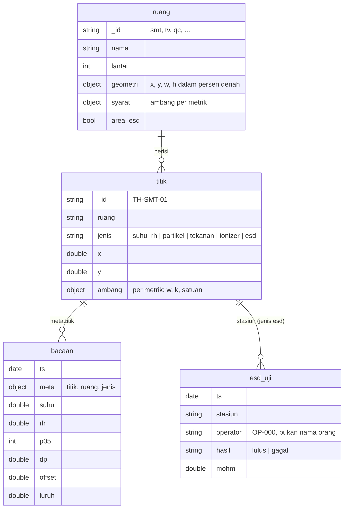

# Model data MongoDB

Database `ruangbersih` di MongoDB 7.0. Skema, validator, indeks, dan data master dibuat oleh
`db/init/01-skema.js` saat volume pertama kali diinisialisasi.

## Pengguna

| Pengguna | Database | Peran | Dipakai oleh |
|---|---|---|---|
| `root` (env `MONGO_ROOT_*`) | admin | root | administrasi saja |
| `app` (env `MONGO_APP_*`) | ruangbersih | `readWrite` | api, simulator |

## Diagram relasi

## Koleksi

### `ruang` (master, 6 dokumen)
Validator `$jsonSchema`: `_id` `^[a-z0-9-]{2,20}$`, wajib `nama`, `lantai`, `geometri`.

### `titik` (master, 15 dokumen)
Validator: `_id` `^[A-Z0-9-]{2,20}$`, `jenis` enum, `x`/`y` 0 sampai 100. Indeks `{ruang: 1}`.
Bentuk ambang setiap metrik: `{ "w": [min, max], "k": [min, max], "satuan": "..." }`, `null` = tidak dibatasi.

### `bacaan` (*time-series collection*)
`timeField: ts`, `metaField: meta`, `granularity: seconds`, `expireAfterSeconds` 30 hari.
Satu dokumen per titik per pembacaan; metrik yang tidak relevan untuk jenisnya tidak ditulis.
Indeks sekunder `{ "meta.titik": 1, ts: -1 }` untuk "bacaan terakhir per titik" dan riwayat.

### `esd_uji`
Satu dokumen per uji gelang ESD. Validator: `operator` `^OP-[0-9]{3}$` (ID anonim, bukan nama),
`hasil` enum. Indeks `{ts: -1}`, `{stasiun: 1, ts: -1}`, dan TTL `retensi_1_tahun` (366 hari)
sebagai jejak audit.

## Kueri utama

| Kebutuhan | Kueri |
|---|---|
| Bacaan terakhir per titik | `$match ts ≥ now-26 jam` → `$sort ts desc` → `$group` per `meta.titik` dengan `$first` |
| Riwayat ter-agregasi | `$match meta.titik, ts` → `$group` per `$dateTrunc` (unit menit, `binSize` langkah) dengan `$avg` |
| Rekap uji hari ini | `$match ts ≥ 00.00 lokal` → `$group` per stasiun + hasil |

## Volume dan retensi (perkiraan)

| Koleksi | Laju | Per hari | Retensi |
|---|---|---|---|
| bacaan | 12 sensor × 1 per 5 dtk | ±207.000 dokumen | 30 hari |
| esd_uji | ±1 per 30 dtk per pabrik | ±1.000 dokumen | 366 hari |

*Time-series collection* menyimpan bucket terkompresi, jadi ukuran di disk jauh lebih kecil daripada
jumlah dokumen. Di produksi, interval 5 detik bisa diturunkan menjadi 30 sampai 60 detik untuk
suhu dan RH tanpa kehilangan informasi berarti.
