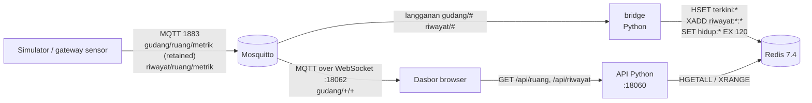

# 06 · Gudang & Cold Storage

Pratinjau konsep dasbor untuk klien, dipakai petugas gudang untuk bereaksi cepat saat suhu ruang
dingin, freezer, atau lemari kering komponen peka kelembapan (MSD) keluar batas, dan saat pintu terbuka
terlalu lama. Tampilan dirancang untuk tablet di dinding gudang maupun desktop. Backend Docker adalah demo
teknis opsional untuk menunjukkan arsitektur yang diusulkan.

> Semua angka adalah **data contoh** dari simulator.

| | |
|---|---|
| Pengguna utama | Petugas gudang |
| Database | Redis 7.4: hash nilai terkini, Redis Streams untuk riwayat 7 hari, kunci TTL untuk deteksi offline |
| Cara menarik data | Browser berlangganan MQTT lewat WebSocket langsung ke broker (Mosquitto 2.0); REST kecil untuk data awal dan riwayat |
| Backend | Python 3.12, `http.server` + `redis` + `paho-mqtt` (satu kode, peran `bridge` dan `api`) |
| Dasbor | http://localhost:18060 |
| Pratinjau tanpa Docker | `web/index.html?pratinjau` |
| Status | Pratinjau konsep (mockup), bukan sistem produksi. Backend demo diuji 5 November 2026. |

## Arsitektur



- Simulator Python melakukan publish MQTT sebagai pengguna `sensor`, dengan pesan retained per metrik.
- Konfigurasi ruang dan ambang ada di satu tempat: `db/ruang.json`, dibaca simulator, API, dan dasbor.
- Status dan hitung mundur pintu dihitung di browser setiap detik dari data terkini, jadi tetap berjalan
  walau tidak ada pesan baru.
- Bila broker tidak menjawab dalam 8 detik atau pustaka MQTT gagal dimuat, dasbor beralih ke polling REST
  setiap 10 detik.
- Frontend memakai HTML, CSS, dan JavaScript tanpa framework; `mqtt.js` 5.10.1 dari CDN; grafik dari
  `../shared/charts.js`.

## Menjalankan

### Pratinjau tanpa instalasi

Buka `web/index.html?pratinjau` di peramban, atau galeri semua proyek di `../pratinjau.html`. Dasbor
memakai `web/contoh.js`. Tanpa `?pratinjau`, dasbor yang dibuka dari berkas menampilkan pita
"Mode data contoh".

### Demo teknis dengan Docker (opsional)

```bash
cp .env.example .env          # ganti sandi bila dipakai di luar laptop pengembang
docker compose -p konsep-06 up -d --build
# dasbor: http://localhost:18060
docker compose -p konsep-06 stop
```

Saat start, simulator mengirim riwayat 24 jam (langkah 5 menit) ke topik `riwayat/...`, lalu nilai
langsung setiap 5 detik.

## Konfigurasi

| Port | Layanan |
|---|---|
| 18060 | Dasbor + API |
| 18061 | MQTT TCP (gateway sensor) |
| 18062 | MQTT over WebSocket (dasbor) |
| 18063 | Redis (hanya `127.0.0.1`) |

| Variabel | Bawaan (`.env.example`) | Arti |
|---|---|---|
| `MQTT_SENSOR_USER`, `MQTT_SENSOR_PASSWORD` | `sensor`, `ganti-sandi-sensor` | Satu-satunya pengguna MQTT yang boleh menulis |
| `REDIS_PASSWORD` | `ganti-sandi-redis` | Sandi Redis |
| `CORS_ORIGIN` | `http://localhost:18060` | Origin yang diizinkan memanggil API |
| `TZ` | `Asia/Jakarta` | Zona waktu |

## Struktur folder

```
api/          app.py (bridge + API + uji mandiri), requirements.txt, Dockerfile
simulator/    sim.py, Dockerfile
mosquitto/    mosquitto.conf, acl
db/           ruang.json (konfigurasi ruang, ambang, batas pintu)
web/          index.html, style.css, app.js, contoh.js
docs/         API.md, DATABASE.md, DAFTAR-TITIK.md, DESAIN.md
```

## Keamanan

- ACL broker: klien anonim (dasbor, bridge) **hanya boleh membaca**; hanya pengguna `sensor` yang boleh
  menulis (`mosquitto/acl`).
- Sandi MQTT dan Redis lewat `.env`; Redis hanya terbuka di `127.0.0.1:18063`.
- CORS hanya mengizinkan `CORS_ORIGIN`; ruang tak dikenal pada `/api/riwayat` ditolak dengan 400.
- Demo memakai MQTT tanpa TLS (`ws://`); lihat batasan.

## Pengujian dan verifikasi

```bash
docker compose -p konsep-06 exec -T api python app.py uji     # uji logika agregasi
curl localhost:18060/api/health
curl localhost:18060/api/ruang
curl "localhost:18060/api/riwayat?ruang=cs-b&metrik=suhu&jam=24&langkah=15"
docker exec konsep-06-mosquitto-1 mosquitto_sub -h localhost -t 'gudang/#' -v -C 5
```

Verifikasi 5 November 2026:

- `docker compose -p konsep-06 up -d --build`: lima layanan jalan, redis sehat.
- Bridge dan simulator tersambung ke broker; riwayat 24 jam (288 langkah) terkirim.
- `/api/health` → `{"status": "ok"}`; `/api/ruang` mengembalikan 10 ruang dengan nilai terkini;
  `/api/riwayat` mengembalikan rata-rata 15 menit; ruang tak dikenal ditolak dengan 400.
- ACL: `mosquitto_pub` anonim ke `gudang/cs-a/suhu` ditolak (nilai di broker tetap dari simulator).
- `python app.py uji` lulus. `mqtt.js` 5.10.1 di unpkg menjawab HTTP 200.
- Tangkapan layar Chrome headless: status "Langsung lewat MQTT", hitung mundur pintu Cold storage B
  berjalan, DC-09 tampil "Belum pernah mengirim data"; mode berkas menampilkan pita data contoh.

## Batasan dan langkah berikutnya

Proyek ini adalah pratinjau konsep. Autentikasi, skala, backup, dan pemantauan produksi berada di luar
cakupan pratinjau dan perlu dirancang bila klien memilih proyek ini untuk dilanjutkan. Hal yang perlu
diperhatikan pada tahap itu:

- Koneksi broker dengan `wss://` di balik reverse proxy dan, bila perlu, pengguna baca-saja bersandi
  untuk dasbor; demo memakai `ws://`.
- Riwayat dari simulator yang di-restart tidak ditulis ulang (ID stream harus naik); itu disengaja.
- Ambang suhu pasta solder, freezer, dan RH lemari kering adalah **contoh**:
  `[REAL DATA: rentang simpan dari lembar data material dan prosedur MSD klien]`.

## Dokumentasi terkait

- [docs/API.md](docs/API.md): topik MQTT, endpoint REST, dan contoh pesan.
- [docs/DATABASE.md](docs/DATABASE.md): kunci Redis, Streams, TTL, dan retensi.
- [docs/DAFTAR-TITIK.md](docs/DAFTAR-TITIK.md): daftar titik sensor gudang beserta ambang.
- [docs/DESAIN.md](docs/DESAIN.md): arah desain dan token warna serta huruf.
