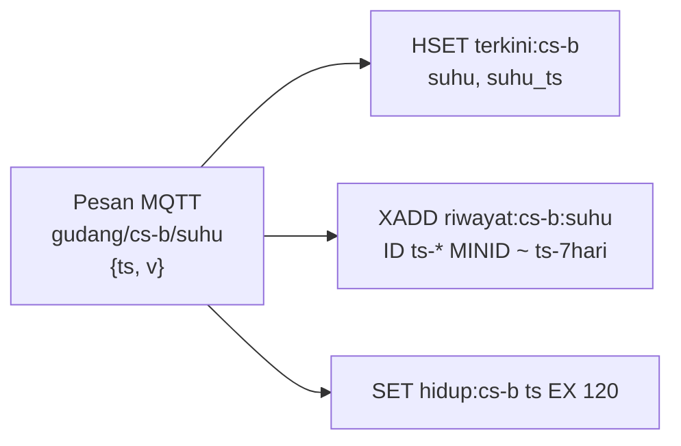

# Model data Redis

Redis 7.4 dengan AOF (`--appendonly yes`) dan sandi (`--requirepass`). Tidak ada skema formal;
struktur kunci di bawah ini adalah kontrak antara bridge (penulis) dan API (pembaca).

## Kunci

| Pola kunci | Tipe | Isi | Ditulis | TTL / retensi |
|---|---|---|---|---|
| `terkini:{ruang}` | hash | `suhu`, `suhu_ts`, `rh`, `rh_ts`, `pintu_terbuka` (0/1), `pintu_sejak`, `pintu_ts` | setiap pesan `gudang/...` | tidak ada (selalu nilai terakhir) |
| `riwayat:{ruang}:{metrik}` | stream | entri ID `{ts_ms}-{seq}`, field `v` | setiap pesan `gudang/...` dan `riwayat/...` | 7 hari lewat `XADD ... MINID ~ (ts - 7 hari)` |
| `hidup:{ruang}` | string | ts pesan terakhir | setiap pesan nilai | `EX 120` detik |

## Pola akses

| Kebutuhan | Perintah | Kompleksitas |
|---|---|---|
| Nilai terkini semua ruang | `HGETALL terkini:*` dalam satu *pipeline* (10 kunci) | O(ruang) |
| Riwayat 24 jam | `XRANGE riwayat:{ruang}:{metrik} {now-24 jam} +` lalu dirata-rata per langkah di API | O(entri) |
| Ruang hidup | `EXISTS hidup:{ruang}` (cadangan; dasbor memakai umur `ts`) | O(1) |

ID stream memakai waktu sensor (`{ts}-*`), sehingga riwayat bisa diisi mundur saat simulator
pertama kali start. Entri dengan waktu lebih tua dari entri terakhir ditolak Redis; bridge
mengabaikannya karena data itu sudah tersimpan.

## Volume (perkiraan)

| Sumber | Laju | Entri per hari |
|---|---|---|
| 11 metrik × 1 pesan per 5 detik | 2,2 pesan/detik | ±190.000 |

Dengan retensi 7 hari, ±1,3 juta entri stream; dengan satu field numerik, ukurannya puluhan MB.
Di produksi, interval suhu 30 sampai 60 detik sudah cukup dan memangkas volume 6 sampai 12 kali.

## Cadangan

AOF di volume `konsep-06_redis-data`. Redis di sini adalah penyimpanan operasional jangka
pendek; untuk arsip mutu jangka panjang, ekspor riwayat harian ke database relasional atau berkas.
