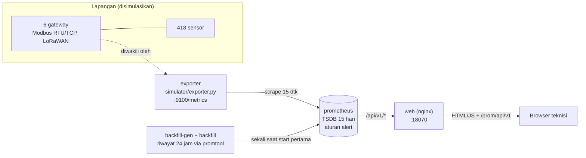

# 07 · NOC Perangkat & Gateway

Pratinjau konsep dasbor untuk klien, ditujukan bagi teknisi IT/OT yang bertugas memulihkan sensor
pabrik yang berhenti mengirim data. Dasbor ini menjawab satu pertanyaan: **sensor mana yang hilang, dan
apa yang harus diperbaiki lebih dulu?** Backend Docker adalah demo teknis opsional untuk menunjukkan
arsitektur yang diusulkan.

> Semua sensor, gateway, dan angka adalah **data contoh** dari simulator.

| | |
|---|---|
| Pengguna utama | Teknisi IT/OT |
| Database | Prometheus 2.53 (TSDB), retensi 15 hari |
| Cara menarik data | PromQL HTTP API (`/api/v1/query`, `/query_range`, `/alerts`) lewat proxy nginx baca-saja |
| Backend | Exporter simulasi Python (stdlib) di `/metrics`, di-scrape tiap 15 detik; nginx sebagai proxy dan penyaji web |
| Dasbor | http://localhost:18070 |
| Pratinjau tanpa Docker | `web/index.html?pratinjau` |
| Status | Pratinjau konsep (mockup), bukan sistem produksi. Backend demo diuji 5 November 2026. |

## Arsitektur



Urutan start: `backfill-gen` menulis riwayat 24 jam beserta waktu jangkar, `backfill` mengubahnya menjadi
blok TSDB dengan `promtool`, lalu `prometheus` dan `exporter` menyala. Waktu jangkar disimpan di volume, jadi
skenario gangguan tetap konsisten walau stack dinyalakan ulang. Aturan alert Prometheus ada di
`db/rules/alerts.yml`. Frontend berupa HTML, CSS, dan JavaScript statis tanpa build, dengan grafik dari
`../shared/charts.js`.

## Menjalankan

### Pratinjau tanpa instalasi

Buka `web/index.html?pratinjau` di peramban, atau galeri semua proyek di `../pratinjau.html`. Dasbor
memakai data contoh bawaan. Tanpa `?pratinjau`, dasbor yang dibuka dari berkas menampilkan pita
penjelasan.

### Demo teknis dengan Docker (opsional)

Prasyarat: Docker Desktop (Compose v2).

```bash
cd 07-noc-perangkat
docker compose -p konsep-07 up -d      # start pertama mengunduh image prometheus, nginx, python
# buka http://localhost:18070
docker compose -p konsep-07 stop       # hentikan tanpa menghapus data
```

## Konfigurasi

| Port | Layanan | Akses |
|---|---|---|
| 18070 | Dasbor + proxy PromQL | semua antarmuka |
| 18071 | UI Prometheus | hanya `127.0.0.1` |
| 18072 | `/metrics` simulator | hanya `127.0.0.1` |

| Variabel | Bawaan | Arti |
|---|---|---|
| `WEB_PORT` | `18070` | Dasbor + proxy PromQL |
| `PROMETHEUS_PORT` | `18071` | UI Prometheus (hanya `127.0.0.1`) |
| `EXPORTER_PORT` | `18072` | `/metrics` simulator (hanya `127.0.0.1`) |
| `RETENSI` | `15d` | Retensi TSDB Prometheus |

Proyek ini tidak memakai rahasia; `.env` hanya perlu dibuat bila ingin mengubah nilai bawaan.

## Struktur folder

```
api/nginx.conf         proxy baca-saja ke Prometheus + penyaji web
db/prometheus.yml      konfigurasi scrape
db/rules/alerts.yml    aturan alert contoh
db/backfill.sh         impor riwayat 24 jam (promtool)
simulator/exporter.py  exporter simulasi + generator backfill + self-check
web/                   dasbor (index.html, style.css, app.js)
docs/                  API, model data, daftar titik, desain
```

## Keamanan

- Proxy hanya membuka `query`, `query_range`, `alerts`, dan `rules` dengan metode GET. Endpoint admin
  Prometheus dan metode lain ditolak (diuji: `/api/v1/admin/...` → 404, POST → 403).
- UI Prometheus dan exporter hanya terikat ke `127.0.0.1`.
- Tidak ada kredensial di proyek ini. Autentikasi (SSO atau basic auth) di nginx perlu dirancang sebelum
  port 18070 dibuka ke jaringan pabrik `[REAL DATA: kebijakan akses jaringan OT klien]`.

## Pengujian dan verifikasi

Diuji 5 November 2026 di Docker Desktop 29.8 (Windows 11):

| Uji | Hasil |
|---|---|
| `python simulator/exporter.py --uji` | `uji ok` (418 sensor unik, skenario gangguan benar) |
| `docker compose -p konsep-07 up -d` | 5 layanan jalan; `backfill` selesai dengan 13 blok TSDB |
| `GET /prom/api/v1/query?query=noc_gateway_up{gateway="GW-GD"}` | nilai `0` |
| `GET /prom/api/v1/query_range` total sensor online | 399 dari 418 |
| `GET /prom/api/v1/alerts` | 13 alert (gateway putus, 2 sensor, 9 baterai, 1 CRC) |
| `GET /prom/api/v1/admin/tsdb/snapshot`, `POST /prom/api/v1/query` | 404, 403 |
| Render dasbor di Edge headless 1920×1080 | tanpa tumpang tindih; sloplint 0 FAIL |

## Batasan dan langkah berikutnya

Proyek ini adalah pratinjau konsep. Autentikasi, skala, backup, dan pemantauan produksi berada di luar
cakupan pratinjau dan perlu dirancang bila klien memilih proyek ini untuk dilanjutkan. Hal yang perlu
diperhatikan pada tahap itu:

- Data demo berasal dari simulator. Gateway nyata memerlukan exporter Modbus atau LoRaWAN network server
  yang mengekspos metrik dengan nama yang sama (lihat `docs/DAFTAR-TITIK.md`).
- Notifikasi (mis. Alertmanager ke WhatsApp atau email); di demo alert hanya tampil di dasbor dan UI
  Prometheus.
- "Dugaan penyebab" di demo adalah aturan sederhana di frontend (gateway putus, galat CRC, baterai di bawah
  5 %).

## Dokumentasi terkait

- [docs/API.md](docs/API.md): kueri PromQL yang dipakai dasbor dan aturan proxy.
- [docs/DATABASE.md](docs/DATABASE.md): model metrik, label, retensi TSDB, dan backfill.
- [docs/DAFTAR-TITIK.md](docs/DAFTAR-TITIK.md): daftar metrik gateway dan sensor.
- [docs/DESAIN.md](docs/DESAIN.md): arah desain dan token warna serta huruf.
