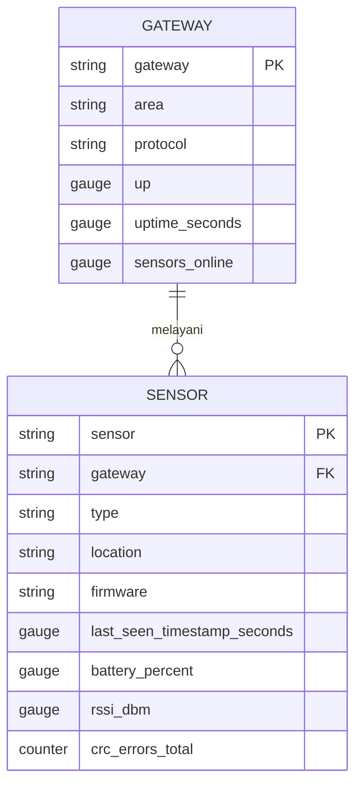

# Model data · NOC Perangkat & Gateway

Basis data proyek ini adalah **TSDB Prometheus**. Tidak ada tabel; data disimpan sebagai *seri waktu* yang
dikenali dari nama metrik dan pasangan label.

## Penyimpanan

| Parameter | Nilai | Tempat diatur |
|---|---|---|
| Interval scrape | 15 detik | `db/prometheus.yml` |
| Retensi | 15 hari | `RETENSI` di `.env`, flag `--storage.tsdb.retention.time` |
| Volume | `konsep-07_prom-data` | `docker-compose.yml` |
| Riwayat awal | 24 jam `noc_gateway_sensors_online`, resolusi 1 menit | `simulator/exporter.py --backfill` + `db/backfill.sh` |

## Metrik

| Metrik | Tipe | Label | Satuan / arti |
|---|---|---|---|
| `noc_gateway_info` | gauge | `gateway`, `area`, `protocol` | selalu 1; identitas |
| `noc_gateway_up` | gauge | `gateway` | 1 terhubung, 0 putus |
| `noc_gateway_uptime_seconds` | gauge | `gateway` | detik sejak restart |
| `noc_gateway_sensors_online` | gauge | `gateway` | jumlah sensor dengan data < 300 detik |
| `noc_sensor_info` | gauge | `sensor`, `gateway`, `type`, `location`, `firmware` | selalu 1; identitas |
| `noc_sensor_last_seen_timestamp_seconds` | gauge | `sensor`, `gateway` | waktu Unix data terakhir |
| `noc_sensor_battery_percent` | gauge | `sensor`, `gateway` | %, hanya LoRa |
| `noc_sensor_rssi_dbm` | gauge | `sensor`, `gateway` | dBm, hanya LoRa |
| `noc_sensor_crc_errors_total` | counter | `sensor`, `gateway` | jumlah frame galat, hanya Modbus |
| `noc_firmware_latest_info` | gauge | `version` | selalu 1; versi rilis terbaru |

Prometheus menambahkan label `job="noc-exporter"` dan `instance="exporter:9100"` ke setiap seri hasil scrape.
Seri backfill memakai label yang sama.

Diagram ini adalah model konseptual; di TSDB, relasi diwujudkan lewat label `gateway` yang sama.

## Kardinalitas dan ukuran

| Kelompok | Seri |
|---|---|
| Gateway (5 metrik × 6) | 30 |
| Sensor info + last seen (2 × 418) | 836 |
| Baterai + RSSI (2 × 126) | 252 |
| CRC (292 sensor Modbus) | 292 |
| Total | ±1.400 seri |

Dengan sekitar 1,5 byte per sampel setelah kompresi, 1.400 seri × 5.760 sampel/hari × 15 hari ≈ 180 MB.
Angka ini adalah perkiraan; ukur ulang dengan `prometheus_tsdb_head_series` setelah dipasang di lapangan.

## Pemeliharaan

- Mengosongkan data dan mengulang skenario: `docker compose -p konsep-07 down -v` (menghapus volume).
- Label `location` dan `firmware` ada di `noc_sensor_info`, bukan di metrik bernilai, supaya perubahan versi
  firmware tidak memecah seri waktu baterai atau last seen.
