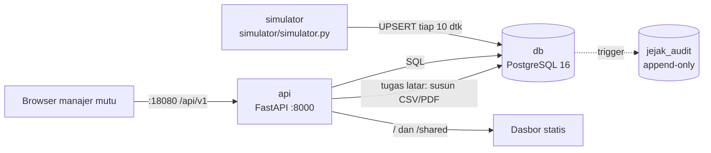
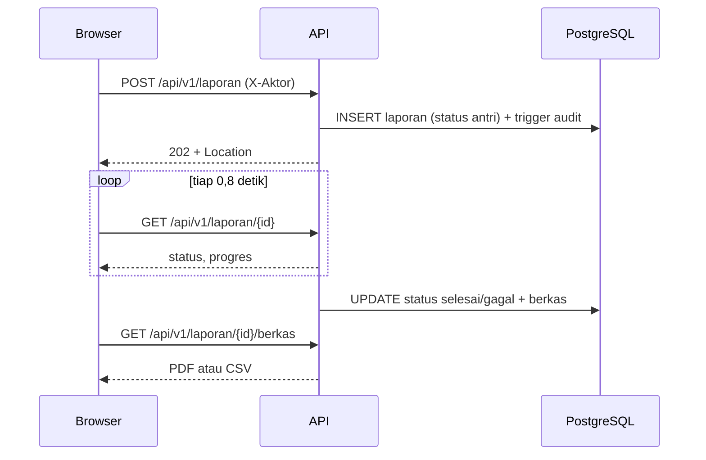

# 08 · Laporan Kepatuhan Mutu

Pratinjau konsep dasbor untuk klien, ditujukan bagi manajer mutu yang menyiapkan bukti audit
(mis. audit sistem manajemen mutu). Pertanyaannya: **area mana yang memenuhi syarat lingkungan pekan ini,
dan laporan apa yang harus diterbitkan?** Backend Docker adalah demo teknis opsional untuk menunjukkan
arsitektur yang diusulkan.

> Semua area, sensor, batas, dan angka adalah **data contoh** dari simulator.

| | |
|---|---|
| Pengguna utama | Manajer mutu |
| Database | PostgreSQL 16, relasional; jejak audit append-only lewat trigger |
| Cara menarik data | REST + OpenAPI 3.1 (`docs/openapi.yaml`), paginasi kursor; laporan asinkron (`POST` → `202` + `Location`, lalu `GET` status, unduh CSV/PDF) |
| Backend | Python 3.12, FastAPI, psycopg 3 (pool) |
| Dasbor | http://localhost:18080 |
| Pratinjau tanpa Docker | `web/index.html?pratinjau` |
| Status | Pratinjau konsep (mockup), bukan sistem produksi. Backend demo diuji 5 November 2026. |

## Arsitektur



Simulator Python mengisi ringkasan harian per area tiap 10 detik dan riwayat 30 hari. Frontend berupa HTML,
CSS, dan JavaScript statis yang disajikan oleh API yang sama (tanpa CORS).

Alur penerbitan laporan:



## Menjalankan

### Pratinjau tanpa instalasi

Buka `web/index.html?pratinjau` di peramban, atau galeri semua proyek di `../pratinjau.html`. Lembar
kepatuhan, daftar laporan, dan jejak audit terisi data contoh; formulir penerbitan dinonaktifkan karena
tidak ada API.

### Demo teknis dengan Docker (opsional)

```bash
cd 08-laporan-kepatuhan
cp .env.example .env            # lalu ganti DB_PASSWORD
docker compose -p konsep-08 up -d --build
# dasbor: http://localhost:18080   dokumentasi API interaktif: http://localhost:18080/docs
docker compose -p konsep-08 stop
```

Tanpa `.env`, Compose berhenti dengan pesan `isi DB_PASSWORD di .env`.

Ekspor ulang spesifikasi OpenAPI setelah mengubah API:

```bash
docker compose -p konsep-08 run --rm --no-deps -v "$PWD/docs:/out" -u 0 api python export_openapi.py /out/openapi.yaml
```

## Konfigurasi

| Port | Layanan | Akses |
|---|---|---|
| 18080 | Dasbor + API + `/docs` | semua antarmuka |
| 18081 | PostgreSQL | hanya `127.0.0.1` |

| Variabel | Bawaan (`.env.example`) | Arti |
|---|---|---|
| `DB_NAME`, `DB_USER` | `mutu` | Basis data dan pengguna PostgreSQL |
| `DB_PASSWORD` | wajib diisi | Kata sandi basis data |
| `WEB_PORT` | `18080` | Dasbor + API |
| `DB_PORT` | `18081` | PostgreSQL (hanya `127.0.0.1`) |
| `AMBANG_PERSEN` | `99` | Ambang kepatuhan dalam persen waktu |
| `TICK_DETIK` | `10` | Interval simulator dalam detik |

## Struktur folder

```
api/main.py            endpoint REST, validasi, tugas latar penyusun laporan
api/berkas.py          CSV dan PDF A4 tanpa pustaka luar (python berkas.py = self-check)
api/export_openapi.py  ekspor docs/openapi.yaml
db/init/01-skema.sql   tabel, indeks, trigger audit, proteksi append-only
db/init/02-seed.sql    area, sensor, batas contoh
simulator/simulator.py pengisi ringkasan harian
web/                   dasbor (index.html, style.css, app.js)
docs/                  API, basis data, daftar titik, desain, openapi.yaml
```

## Keamanan

- Kata sandi basis data hanya lewat `.env` (diabaikan git); Compose menolak jalan tanpa nilai itu.
- PostgreSQL hanya terikat ke `127.0.0.1`. API berjalan sebagai pengguna non-root di container.
- Semua input divalidasi Pydantic: jenis, format, kode area, rentang tanggal maksimal 93 hari. Kursor yang
  rusak dijawab `400`, bukan `500`. Header `X-Aktor` dibatasi 60 karakter dan karakter aman.
- `jejak_audit` tidak bisa diubah atau dihapus: trigger menolak `UPDATE`, `DELETE`, dan `TRUNCATE`
  (diuji langsung lewat `psql`).
- Demo tidak memakai autentikasi: identitas penyusun diambil dari header `X-Aktor` (lihat batasan).

## Pengujian dan verifikasi

Diuji 5 November 2026 di Docker Desktop 29.8 (Windows 11):

| Uji | Hasil |
|---|---|
| `python api/berkas.py` | `cek berkas ok` (PDF 3 halaman valid, CSV ber-BOM) |
| `docker compose -p konsep-08 up -d --build` | 3 layanan jalan; simulator mengisi 248 baris riwayat |
| `GET /healthz`, `GET /api/v1/kepatuhan?hari=3` | `200`, data 8 area |
| `POST /api/v1/laporan` kepatuhan PDF | `202` + `Location`; `selesai` dalam ±2 detik; unduhan `application/pdf` diawali `%PDF-1.4` |
| `GET .../berkas` saat masih disusun | `409` dengan pesan status |
| `POST` periode Januari 2025 | `202`, lalu `gagal`: "Tidak ada data kepatuhan … Data tersedia mulai 6 Oktober 2026. Pilih periode lain." |
| `POST` tanggal terbalik / area `XYZ` | `422` dengan pesan berbahasa Indonesia |
| Paginasi `limit=2` + `cursor_berikut` | halaman 2 benar, `cursor_berikut` null di akhir; kursor rusak → `400` |
| `UPDATE`/`DELETE` pada `jejak_audit` lewat `psql` | ditolak: "jejak_audit hanya boleh ditambah (append-only)" |
| Render dasbor (API dan mode file) di Edge headless 1920×1080 | tanpa tumpang tindih; sloplint 0 FAIL |

## Batasan dan langkah berikutnya

Proyek ini adalah pratinjau konsep. Autentikasi, skala, backup, dan pemantauan produksi berada di luar
cakupan pratinjau dan perlu dirancang bila klien memilih proyek ini untuk dilanjutkan. Hal yang perlu
diperhatikan pada tahap itu:

- SSO perusahaan menggantikan header `X-Aktor`, dengan aktor diisi dari token
  `[REAL DATA: penyedia identitas klien]`. Pisahkan juga peran basis data (pemilik skema dan pengguna
  aplikasi) supaya aplikasi tidak bisa mematikan trigger audit.
- Ringkasan harian di demo berasal dari simulator. Di lapangan, tabel ini diisi oleh job agregasi dari data
  sensor mentah (mis. tiap menit) dengan aturan batas di tabel `batas`.
- Penyusun laporan di demo berjalan sebagai tugas latar di proses API; laporan yang sedang disusun saat API
  restart ditandai `gagal`. Untuk laporan besar, gunakan antrean (Celery/RQ).
- PDF demo berupa teks satu kolom berhuruf Courier. Untuk kop surat dan tanda tangan digital, pakai mesin
  PDF seperti WeasyPrint.

## Dokumentasi terkait

- [docs/API.md](docs/API.md): endpoint REST, alur laporan asinkron, paginasi, dan galat.
- [docs/openapi.yaml](docs/openapi.yaml): spesifikasi OpenAPI 3.1 hasil ekspor.
- [docs/DATABASE.md](docs/DATABASE.md): skema relasional, trigger audit, dan indeks.
- [docs/DAFTAR-TITIK.md](docs/DAFTAR-TITIK.md): area, sensor, dan batas kepatuhan.
- [docs/DESAIN.md](docs/DESAIN.md): arah desain dan token warna serta huruf.
