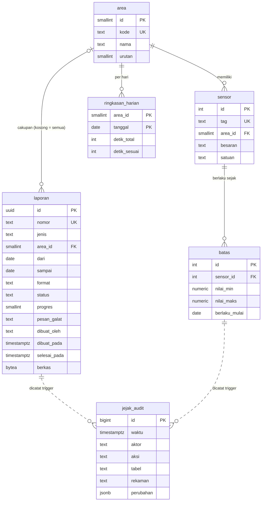

# Basis data · Laporan Kepatuhan Mutu

PostgreSQL 16, zona waktu `Asia/Jakarta`. Skema lengkap: `db/init/01-skema.sql`; data awal:
`db/init/02-seed.sql`. Keduanya dijalankan otomatis saat volume `konsep-08_pg-data` masih kosong.

## Diagram relasi

## Tabel

| Tabel | Isi | Batasan penting |
|---|---|---|
| `area` | 8 area produksi dan penyimpanan | `kode` cocok `^[A-Z0-9-]{2,16}$` |
| `sensor` | sensor yang menentukan kepatuhan area | `tag` unik |
| `batas` | batas min/maks per sensor dengan tanggal berlaku | minimal satu batas terisi; `min < maks`; unik per (sensor, tanggal) |
| `ringkasan_harian` | detik terpantau dan detik dalam syarat per area per hari | `0 ≤ detik_sesuai ≤ detik_total ≤ 86.400` |
| `laporan` | permintaan laporan, status, berkas hasil | `jenis`, `format`, `status` dibatasi CHECK; `sampai ≥ dari`; `progres` 0 sampai 100 |
| `jejak_audit` | catatan perubahan `laporan` dan `batas` | append-only |

## Indeks

| Indeks | Untuk |
|---|---|
| `laporan_urut (dibuat_pada DESC, id DESC)` | paginasi kursor daftar laporan |
| `jejak_audit_waktu (waktu)` | ekspor audit per periode; daftar audit memakai PK `id` |
| `ringkasan_tanggal (tanggal)` | laporan lintas area per periode |
| `sensor_area (area_id)` | relasi sensor per area |

## Jejak audit

- Fungsi `catat_audit()` dipicu oleh `laporan` (INSERT, DELETE, UPDATE kolom `status`) dan `batas` (semua
  perubahan). Perubahan `progres` tidak dicatat agar audit tidak berisi ratusan baris kemajuan.
- Aktor diambil dari `current_setting('app.aktor')` yang diisi API per transaksi
  (`set_config('app.aktor', ..., true)`); bila kosong, nama pengguna basis data dipakai.
- Kolom `berkas` (biner) tidak ikut disalin ke audit.
- Trigger `jejak_audit_append_only` dan `jejak_audit_tanpa_truncate` menolak perubahan apa pun pada audit.
  Pemilik skema masih bisa mematikan trigger, jadi di produksi aplikasi harus memakai peran tanpa hak `ALTER`.

## Retensi dan ukuran

| Data | Perkiraan | Saran retensi |
|---|---|---|
| `ringkasan_harian` | 8 area × 365 hari ≈ 2.920 baris/tahun (< 1 MB) | simpan permanen |
| `laporan` + berkas | PDF ±3 sampai 10 KB, CSV ±10 sampai 50 KB | `[REAL DATA: masa simpan rekaman mutu klien]` |
| `jejak_audit` | beberapa baris per laporan | sama dengan masa simpan rekaman mutu |

Cadangan: `pg_dump` harian volume `pg-data` `[REAL DATA: kebijakan backup klien]`.
