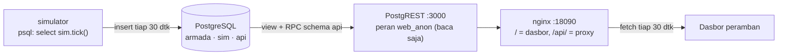

# 09 · Armada AC Pintar (Purnajual)

Pratinjau konsep dasbor untuk klien, ditujukan bagi tim layanan purnajual: mendeteksi AC pelanggan
yang perlu servis **sebelum pelanggan komplain**, dari telemetri unit yang terhubung (suhu set/ruang, arus
kompresor, tekanan hisap, kode galat). Backend Docker adalah demo teknis opsional untuk menunjukkan
arsitektur yang diusulkan.

> Semua angka, kota, model, dan kode galat adalah **data contoh**. Data pelanggan disamarkan (hanya kode
> `PLG-xxxxxx`), tanpa nama, alamat, atau nomor telepon.

| | |
|---|---|
| Pengguna utama | Tim layanan purnajual |
| Database | PostgreSQL 16: tabel inti (`armada`), simulator (`sim`), permukaan API (`api`) |
| Cara menarik data | REST otomatis dari skema lewat PostgREST v12: view dengan filter query string + satu fungsi RPC |
| Backend | Tanpa kode backend: PostgREST + nginx (proxy `/api`, satu origin) |
| Dasbor | http://localhost:18090 |
| Pratinjau tanpa Docker | `web/index.html?pratinjau` |
| Status | Pratinjau konsep (mockup), bukan sistem produksi. Backend demo diuji 5 November 2026. |

## Arsitektur



Simulator (`psql` + PL/pgSQL) menulis telemetri 240 unit tiap 30 detik dan mengisi riwayat 24 jam saat
start. Dasbor (HTML + JavaScript tanpa framework) memanggil view dengan filter di query string
(`?status=neq.normal&order=status`) dan satu fungsi RPC untuk ringkasan. Detail: [docs/API.md](docs/API.md).

## Menjalankan

### Pratinjau tanpa instalasi

Buka `web/index.html?pratinjau` di peramban, atau galeri semua proyek di `../pratinjau.html`. Dasbor
memakai data contoh bawaan. Tanpa `?pratinjau`, dasbor yang dibuka dari berkas menampilkan pita
"Mode data contoh".

### Demo teknis dengan Docker (opsional)

```bash
cp .env.example .env        # lalu isi sandi
docker compose up -d        # proyek compose: konsep-09
# buka http://localhost:18090
docker compose stop         # hentikan
```

Start pertama mengisi 24 jam telemetri (±69 ribu baris, beberapa detik). Memuat ulang skema dan data contoh
tanpa menghapus volume:

```bash
docker compose exec db sh /docker-entrypoint-initdb.d/reset.sh   # Git Bash: awali dengan MSYS_NO_PATHCONV=1
```

## Konfigurasi

| Port (localhost) | Layanan |
| --- | --- |
| 18090 | Dasbor + `/api` |
| 18091 | PostgreSQL (untuk alat seperti DBeaver/psql) |
| 18092 | PostgREST langsung (dokumen OpenAPI otomatis di `/`) |

| Variabel | Bawaan (`.env.example`) | Arti |
| --- | --- | --- |
| `POSTGRES_USER` | `armada_admin` | Pengguna admin PostgreSQL |
| `POSTGRES_PASSWORD` | wajib diganti | Sandi admin PostgreSQL |
| `AUTHENTICATOR_PASSWORD` | wajib diganti | Sandi peran `authenticator` yang dipakai PostgREST |
| `TICK_DETIK` | `30` | Interval simulator menulis telemetri (detik) |

## Struktur folder

```
docker-compose.yml   .env.example
db/00-peran.sh       peran authenticator + web_anon (sandi dari env)
db/01-skema.sql      tabel inti schema armada
db/02-seed.sql       6 kota, 240 unit, kode galat generik, tiket
db/03-simulator.sql  fungsi sim.tulis / sim.backfill / sim.tick
db/04-api.sql        view & RPC schema api + hak akses
db/reset.sh          muat ulang skema dan data contoh
web/                 index.html, style.css, app.js, nginx.conf
docs/                API, DATABASE, DAFTAR-TITIK, DESAIN
```

## Keamanan

- PostgREST login sebagai `authenticator` (tanpa hak sendiri) lalu beralih ke `web_anon` yang hanya boleh
  `SELECT` view di schema `api` dan menjalankan `api.ringkasan_armada()`. Tabel inti tidak terekspos
  (`/unit` → 404).
- nginx hanya meneruskan GET/HEAD/POST ke `/api` (DELETE → 403). POST diperlukan untuk RPC; RPC bersifat
  baca.
- Sandi lewat `.env` (diabaikan git). Port DB dan PostgREST hanya diikat ke `127.0.0.1`.
- Demo hanya baca. JWT PostgREST untuk peran tulis (mis. teknisi menutup tiket) dan TLS di depan nginx
  perlu dirancang pada tahap lanjutan.

## Pengujian dan verifikasi

Verifikasi 5 November 2026:

- `GET /api/rpc/ringkasan_armada` → 200, `{"total":240,"terhubung":237,...}`.
- `GET /api/unit_status?status=neq.normal` → daftar unit bermasalah dengan alasan dan tiket.
- `GET :18092/unit` → 404 (tabel inti tidak terekspos); `DELETE /api/tiket?id=eq.1` → 403.
- Tangkapan layar Edge headless 1920×1080: mode API dan mode data contoh (`file://`) tampil benar.
- `sloplint` design-guide: 0 FAIL. Kontras teks redup 5,2:1, aksen 5,2:1.

## Batasan dan langkah berikutnya

Proyek ini adalah pratinjau konsep. Autentikasi, skala, backup, dan pemantauan produksi berada di luar
cakupan pratinjau dan perlu dirancang bila klien memilih proyek ini untuk dilanjutkan. Hal yang perlu
diperhatikan pada tahap itu:

- Kode galat di demo generik, bukan tabel resmi pabrikan: `[REAL DATA: tabel kode galat resmi]`.
- Model unit ditulis generik (`Split dinding 1 PK`): `[REAL DATA: kode model resmi]`.
- Tekanan hisap adalah perkiraan dari sensor suhu pipa; ambang 115 psi contoh untuk R32.
- Tombol aksi di demo tidak menulis ke database (PostgREST hanya baca). "Salin ringkasan masalah" menyalin
  teks ke papan klip untuk ditempel di sistem tiket yang ada.

## Dokumentasi terkait

- [docs/API.md](docs/API.md): view dan RPC PostgREST, filter, dan contoh jawaban.
- [docs/DATABASE.md](docs/DATABASE.md): schema `armada`, `sim`, dan `api`, peran, serta indeks.
- [docs/DAFTAR-TITIK.md](docs/DAFTAR-TITIK.md): titik telemetri AC beserta satuan dan ambang.
- [docs/DESAIN.md](docs/DESAIN.md): arah desain dan token warna serta huruf.
