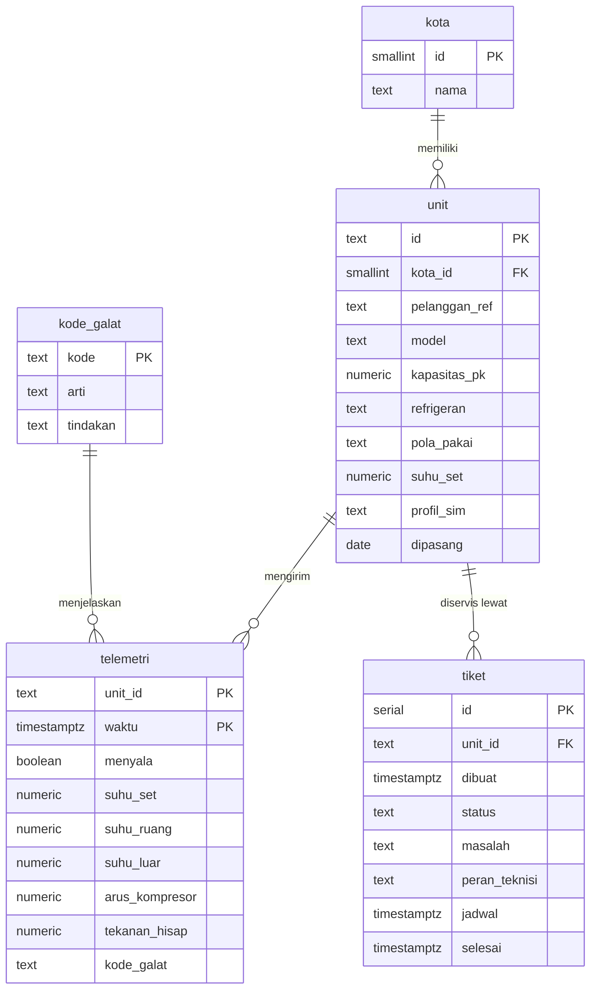

# Basis data · Armada AC Pintar

PostgreSQL 16, satu database `armada`, tiga schema:

| Schema | Isi | Siapa yang mengakses |
| --- | --- | --- |
| `armada` | tabel inti | pemilik (`armada_admin`), simulator |
| `sim` | fungsi simulator | container simulator |
| `api` | view + fungsi RPC | PostgREST sebagai `web_anon` (SELECT saja) |

## Diagram relasi

`telemetri.kode_galat` tidak diberi foreign key dengan sengaja: unit di lapangan bisa mengirim kode baru yang
belum ada di kamus; data tetap diterima, view `galat_24jam` hanya menampilkan kode yang dikenal.

## Indeks

| Indeks | Untuk |
| --- | --- |
| `telemetri (unit_id, waktu)` primary key | pembacaan terakhir per unit (`LATERAL ... ORDER BY waktu DESC LIMIT 1`) dan grafik per unit |
| `telemetri_waktu_idx (waktu DESC)` | retensi dan agregat 24 jam |
| `tiket_status_idx (status)` | tiket terbuka |

## Aturan status

Dihitung di view `api.unit_status` dari pembacaan terakhir tiap unit:

| Status | Syarat (diperiksa berurutan) |
| --- | --- |
| `offline` | belum ada pembacaan atau pembacaan terakhir lebih dari 15 menit lalu |
| `kritis` | unit melaporkan kode galat |
| `perlu_servis` | unit menyala dan salah satu: suhu ruang > suhu set + 2,5 °C; tekanan hisap < 115 psi; arus kompresor > 125 % arus nominal (3,9 A per PK) |
| `normal` | selain di atas |

Ambang di atas adalah contoh yang perlu dikalibrasi dengan data lapangan dan spesifikasi model. Ubah di satu
tempat: `db/04-api.sql`.

## Volume & retensi

- 240 unit × 1 baris per 30 detik ≈ 691 ribu baris per hari (±70 MB dengan indeks).
- Retensi data mentah 7 hari, dihapus oleh `sim.tick()`. Untuk produksi: pindahkan ke tugas terjadwal
  (pg_cron) dan simpan agregat per jam untuk riwayat panjang, atau pakai partisi per hari.

## Simulator

`db/03-simulator.sql`. Profil per unit di kolom `unit.profil_sim`:

| Profil | Perilaku | Status yang muncul |
| --- | --- | --- |
| `normal` | pola pakai rumah (malam) atau kantor (jam kerja) | normal |
| `freon` | tekanan hisap turun 40 psi dalam 24 jam, ruang makin hangat; sebagian unit memunculkan `P2` | perlu servis lalu kritis |
| `kondensor` | arus kompresor 140 % nominal; sebagian unit memunculkan `E5` 3 jam terakhir | perlu servis / kritis |
| `sensor` | suhu ruang kosong, kode `E1` | kritis |
| `offline` | berhenti mengirim 95 menit terakhir | offline |

Fungsi: `sim.backfill()` (sekali, 24 jam tiap 5 menit), `sim.tick()` (tiap `TICK_DETIK`), `sim.tulis(t, mulai)`.
