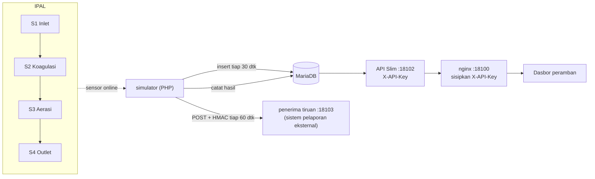

# 10 · IPAL & Emisi Lingkungan

Pratinjau konsep dasbor untuk klien, ditujukan bagi petugas HSE: menjaga air limbah yang keluar dari
IPAL tetap **di bawah baku mutu**, melihat kejadian yang melewati batas, dan memastikan data terkirim ke
sistem pelaporan lingkungan. Backend Docker adalah demo teknis opsional untuk menunjukkan arsitektur yang
diusulkan.

> Semua angka adalah **data contoh**. Nilai baku mutu di database adalah contoh dan harus diganti sesuai izin
> pembuangan air limbah klien `[REAL DATA: baku mutu sesuai izin]`. Format sistem pelaporan eksternal belum
> diketahui `[REAL DATA: spesifikasi sistem pelaporan lingkungan]`.

| | |
|---|---|
| Pengguna utama | Petugas HSE |
| Database | MariaDB 11.4: titik sampling, parameter & baku mutu, pembacaan online, hasil lab, kejadian, log webhook |
| Cara menarik data | REST `/api/v1` dengan header `X-API-Key`, ditambah webhook keluar (push) ke sistem pelaporan |
| Backend | PHP 8.3 + Slim 4 + PDO |
| Dasbor | http://localhost:18100 |
| Pratinjau tanpa Docker | `web/index.html?pratinjau` |
| Status | Pratinjau konsep (mockup), bukan sistem produksi. Backend demo diuji 5 November 2026. |

## Arsitektur



- Simulator (PHP CLI) membangkitkan sensor online pH, COD, TSS, NH3-N, debit, dan suhu di S1 sampai S4,
  mendeteksi kejadian, dan mengirim webhook.
- Penerima tiruan (PHP) menggantikan sistem pelaporan: memverifikasi HMAC dan sengaja menolak tiap permintaan
  ke-4 (503).
- Dasbor (HTML + JavaScript, nginx) memakai proxy `/api/` yang menyisipkan kunci API, jadi kunci tidak sampai
  ke peramban. Detail: [docs/API.md](docs/API.md), spesifikasi mesin: [docs/openapi.yaml](docs/openapi.yaml).

## Menjalankan

### Pratinjau tanpa instalasi

Buka `web/index.html?pratinjau` di peramban, atau galeri semua proyek di `../pratinjau.html`. Dasbor
memakai data contoh bawaan. Tanpa `?pratinjau`, dasbor yang dibuka dari berkas menampilkan pita
"Mode data contoh".

### Demo teknis dengan Docker (opsional)

```bash
cp .env.example .env          # isi sandi, API_KEY, WEBHOOK_SECRET (openssl rand -hex 24)
docker compose up -d --build  # proyek compose: konsep-10
# buka http://localhost:18100
docker compose stop
```

Start pertama mengisi 24 jam data tiap 2 menit (±17 ribu baris) beserta dua skenario: lonjakan COD di outlet
sekitar 3 jam sebelum start (sudah selesai) dan amonia outlet yang melewati baku mutu mulai 50 menit sebelum
start sampai 90 menit sesudahnya (kejadian berlangsung). Skenario mengacu ke waktu backfill, jadi tetap sama
walau simulator di-restart.

## Konfigurasi

| Port (localhost) | Layanan |
| --- | --- |
| 18100 | Dasbor + `/api/v1` (kunci disisipkan nginx) |
| 18101 | MariaDB |
| 18102 | API langsung (wajib header `X-API-Key`) |
| 18103 | Penerima webhook tiruan |

| Variabel | Bawaan (`.env.example`) | Arti |
| --- | --- | --- |
| `DB_USER`, `DB_PASSWORD` | `ipal_app`, wajib diganti | Pengguna aplikasi MariaDB |
| `DB_ROOT_PASSWORD` | wajib diganti | Sandi root MariaDB |
| `API_KEY` | wajib diganti | Kunci header `X-API-Key` (minimal 32 karakter acak) |
| `WEBHOOK_SECRET` | wajib diganti | Rahasia HMAC tanda tangan webhook, disepakati dengan penerima |
| `TICK_DETIK` | `30` | Interval simulator (detik) |
| `WEBHOOK_DETIK` | `60` | Interval pengiriman webhook (detik) |

## Struktur folder

```
docker-compose.yml  .env.example
api/Dockerfile      satu image PHP untuk api, simulator, penerima
api/composer.json   slim/slim, slim/psr7
api/public/index.php  rute REST
api/src/db.php      koneksi PDO (env)
simulator/sim.php   simulator + deteksi kejadian + pengirim webhook
penerima/index.php  penerima webhook tiruan
db/01-skema.sql  db/02-seed.sql
web/                index.html, style.css, app.js, nginx.conf.template
docs/               API, openapi.yaml, DATABASE, DAFTAR-TITIK, DESAIN
```

## Keamanan

- Semua rute kecuali `/api/v1/sehat` wajib `X-API-Key`, dibandingkan dengan `hash_equals` (waktu konstan).
- Dasbor tidak memegang kunci: nginx menyisipkannya di sisi server dan hanya meneruskan GET.
- Input query divalidasi terhadap daftar putih (`titik`, `parameter`, `status`) dan rentang angka; SQL memakai
  prepared statement tanpa emulasi.
- Webhook ditandatangani HMAC-SHA256 (`X-Signature-256: sha256=<hex>`) dan membawa `X-Idempotency-Key`
  supaya penerima bisa menolak kiriman ganda.
- Galat basis data tidak membocorkan detail ke klien (dicatat di log, klien menerima 503).
- Rahasia di `.env` (diabaikan git); port selain dasbor terikat ke `127.0.0.1`.

## Pengujian dan verifikasi

Verifikasi 5 November 2026:

- `GET /api/v1/sehat` → 200; `GET :18102/api/v1/titik` tanpa kunci → 401; `POST /api/v1/titik` lewat
  nginx → 403.
- `GET /api/v1/pembacaan?titik=S9&parameter=cod` → 400 dengan pesan pilihan yang sah; rute tak dikenal →
  404 JSON.
- Kejadian terbentuk otomatis: COD S4 puncak 135,6 mg/L (selesai, 32 menit) dan amonia S4 6,3 mg/L
  (berlangsung).
- Webhook: permintaan ke-4 dijawab 503 dan tercatat `gagal`; percobaan berikutnya mengirim ulang rentang yang
  sama (`dari` tetap di pengiriman sukses terakhir).
- Tangkapan layar Edge headless 1920×1080 mode API dan mode data contoh. `sloplint`: 0 FAIL.

## Batasan dan langkah berikutnya

Proyek ini adalah pratinjau konsep. Autentikasi, skala, backup, dan pemantauan produksi berada di luar
cakupan pratinjau dan perlu dirancang bila klien memilih proyek ini untuk dilanjutkan. Hal yang perlu
diperhatikan pada tahap itu:

- Demo memakai server PHP bawaan; tahap lanjutan memerlukan php-fpm, TLS di depan nginx, serta rotasi kunci
  API dan rahasia webhook.
- Baku mutu, laboratorium, dan format pelaporan menunggu dokumen klien (lihat penanda `[REAL DATA]`).
- Status baku mutu di demo hanya dinilai di outlet S4; titik lain ditampilkan sebagai "dipantau".
- Rata-rata dihitung per kelompok waktu (`interval`), bukan rata-rata harian regulatif.

## Dokumentasi terkait

- [docs/API.md](docs/API.md): endpoint REST, kunci API, webhook keluar, dan contoh jawaban.
- [docs/openapi.yaml](docs/openapi.yaml): spesifikasi OpenAPI API REST.
- [docs/DATABASE.md](docs/DATABASE.md): skema MariaDB, baku mutu, kejadian, dan log webhook.
- [docs/DAFTAR-TITIK.md](docs/DAFTAR-TITIK.md): titik sampling S1 sampai S4 dan parameternya.
- [docs/DESAIN.md](docs/DESAIN.md): arah desain dan token warna serta huruf.
