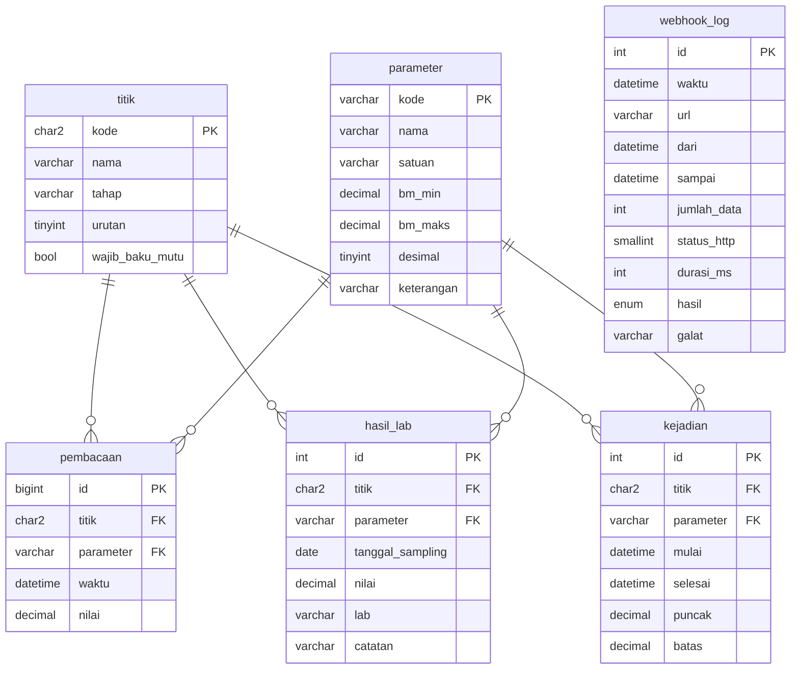

# Basis data · IPAL & Emisi Lingkungan

MariaDB 11.4, database `ipal`, InnoDB, `utf8mb4`. Semua kolom waktu `DATETIME` dalam **WIB** (koneksi PDO
mengatur `time_zone = '+07:00'`, container `TZ=Asia/Jakarta`).

## Diagram relasi



## Tabel

| Tabel | Isi | Catatan |
| --- | --- | --- |
| `titik` | S1 inlet, S2 koagulasi, S3 aerasi, S4 outlet | `wajib_baku_mutu` hanya S4 (titik buang) |
| `parameter` | pH, COD, TSS, NH3-N, debit, suhu | `bm_min`/`bm_maks` NULL = tanpa baku mutu. **Nilai contoh.** |
| `pembacaan` | data sensor online | unik `(titik, parameter, waktu)`; `INSERT IGNORE` membuat penulisan ulang aman |
| `hasil_lab` | uji laboratorium | pembanding/verifikasi sensor online |
| `kejadian` | rentang nilai S4 di luar baku mutu | `selesai` NULL = masih berlangsung; `puncak` diperbarui selama berlangsung |
| `webhook_log` | tiap percobaan kirim ke sistem pelaporan | `hasil` terkirim/gagal, kode HTTP, galat |

## Indeks

| Indeks | Untuk |
| --- | --- |
| `pembacaan uq_bacaan (titik, parameter, waktu)` | grafik per titik-parameter, nilai terakhir, cegah duplikat |
| `pembacaan ix_waktu (waktu)` | retensi, pemilihan pembacaan pada waktu tertentu saat deteksi kejadian |
| `kejadian ix_kejadian_aktif (titik, parameter, selesai)` | mencari kejadian yang masih terbuka |
| `hasil_lab ix_lab (titik, tanggal_sampling)` | daftar hasil lab per titik |
| `webhook_log ix_webhook_waktu (waktu)` | ringkasan 24 jam |

## Logika kejadian

Setelah setiap penulisan, simulator memeriksa pembacaan titik `wajib_baku_mutu` pada waktu itu:

1. Di luar `[bm_min, bm_maks]` dan belum ada kejadian terbuka → buat kejadian (`mulai`, `puncak`, `batas`).
2. Masih di luar → perbarui `puncak = GREATEST(puncak, nilai)`.
3. Kembali di dalam batas → isi `selesai`.

Di produksi logika ini sebaiknya berjalan di layanan pengumpul data (bukan simulator), atau sebagai event
terjadwal MariaDB.

## Volume & retensi

- 4 titik × 6 parameter × 1 pembacaan per 30 detik ≈ 69 ribu baris per hari (±8 MB dengan indeks).
- Data mentah disimpan 90 hari (dihapus saat simulator start). Untuk laporan tahunan simpan agregat harian,
  atau partisi `pembacaan` per bulan (`PARTITION BY RANGE (TO_DAYS(waktu))`).
- `webhook_log` disimpan sebagai jejak audit pelaporan; jangan dihapus otomatis.

## Mengganti baku mutu

```sql
update parameter set bm_maks = <nilai sesuai izin>, keterangan = 'Izin no. <nomor>' where kode = 'cod';
```
Kejadian lama tetap menyimpan `batas` saat kejadian terjadi.
