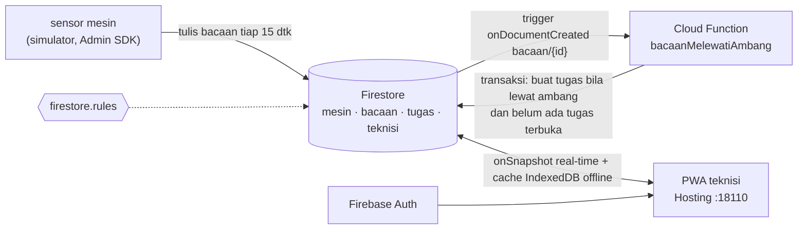

# 11 · Aplikasi Teknisi Lapangan (Firebase)

Pratinjau konsep aplikasi HP (PWA) untuk klien: teknisi **menerima dan menutup tugas** yang dibuat
otomatis saat sensor mesin melewati ambang. Daftar tugas berubah seketika lewat listener Firestore, dan
tetap bisa dipakai saat sinyal hilang (perubahan disimpan di HP lalu disinkronkan). Backend Docker adalah
demo teknis opsional untuk menunjukkan arsitektur yang diusulkan, dijalankan di Firebase Emulator Suite
lokal: tanpa akun Google, tanpa biaya, tanpa data keluar.

> Mesin, lokasi, akun teknisi, dan semua angka adalah **data contoh**.

| | |
|---|---|
| Pengguna utama | Teknisi lapangan (HP) |
| Database | Cloud Firestore (di demo: Firestore emulator) |
| Cara menarik data | Listener real-time `onSnapshot` + cache IndexedDB offline |
| Backend | Cloud Function `bacaanMelewatiAmbang` (Node.js 20) + Firebase Authentication |
| Dasbor | http://localhost:18110 |
| Pratinjau tanpa Docker | `web/index.html?pratinjau` |
| Status | Pratinjau konsep (mockup), bukan sistem produksi. Backend demo diuji 5 November 2026 dengan emulator lokal. |

## Arsitektur



| Komponen | Di emulator (docker compose) | Di Firebase (docs/CLOUD.md) |
| --- | --- | --- |
| Basis data | Firestore emulator | Cloud Firestore |
| Masuk | Auth emulator, dua akun teknisi demo | Firebase Authentication (akun perusahaan) |
| Logika server | Cloud Function `bacaanMelewatiAmbang` (Node.js 20) di Functions emulator | Cloud Functions generasi 2, kode sama |
| Aplikasi | Hosting emulator, `public/` disusun `alat/bangun.mjs` | Firebase Hosting |
| Data sensor | `simulator/sim.mjs` (Admin SDK) | gateway pabrik menulis lewat Admin SDK / layanan ingest |

Aplikasi menarik data lewat listener real-time `onSnapshot`, bukan polling. Detail: [docs/API.md](docs/API.md).

## Menjalankan

### Pratinjau tanpa instalasi

Buka `web/index.html?pratinjau` di peramban, atau galeri semua proyek di `../pratinjau.html`. Aplikasi
memakai data contoh, dan tombol ambil/tutup tugas tetap berfungsi secara lokal.

### Demo teknis dengan Docker (opsional)

```bash
cp .env.example .env          # isi DEMO_SANDI (minimal 8 karakter)
docker compose -p konsep-11 up -d --build
# build pertama mengunduh Java + firebase-tools (beberapa menit); data siap ±1 menit setelah start
# aplikasi:     http://localhost:18110          (pilih akun demo)
# langsung masuk: http://localhost:18110/?demo  (akun demo pertama, hanya di emulator)
# Emulator UI:  http://localhost:18114
docker compose -p konsep-11 stop
```

## Konfigurasi

| Port (hanya 127.0.0.1) | Layanan |
| --- | --- |
| 18110 | Hosting (aplikasi) |
| 18111 | Firestore emulator (dipakai langsung oleh aplikasi) |
| 18112 | Auth emulator |
| 18113 | Functions emulator |
| 18114 | Emulator UI (lihat dokumen, log fungsi) |
| 18115 sampai 18117 | hub, logging, websocket Firestore untuk UI |

Kode yang sama dipakai untuk emulator dan Firebase asli; bedanya hanya di `.env`:

| Variabel | Set EMULATOR (bawaan) | Set CLOUD |
| --- | --- | --- |
| `FIREBASE_EMULATOR` | `1` | `0` |
| `FIREBASE_PROJECT_ID` | `demo-konsep` (awalan `demo-` = tanpa akun Google) | ID proyek Firebase klien |
| `FIREBASE_API_KEY` | `demo-api-key` | kunci web aplikasi klien |
| `FIREBASE_AUTH_DOMAIN`, `FIREBASE_APP_ID` | tidak dipakai | dari konsol Firebase klien |
| `DEMO_SANDI` | sandi dua akun teknisi demo (minimal 8 karakter) | tidak dipakai |
| `TICK_DETIK` | `15` | tidak dipakai (data dari gateway) |

## Struktur folder

```
firebase.json            konfigurasi emulator, hosting, functions
firestore.rules          aturan keamanan (diuji simulator/uji-rules.mjs)
firestore.indexes.json   indeks komposit untuk deploy
functions/index.js       Cloud Function trigger bacaan -> tugas
alat/bangun.mjs          susun public/ = web/ + shared/ + konfigurasi.js dari env
emulator.Dockerfile      Node 20 + Java 17 + firebase-tools 13.35.1
simulator/               sim.mjs (data contoh), uji-rules.mjs (uji aturan), Dockerfile
web/                     PWA: index.html, style.css, app.js, sw.js, manifest, ikon sementara
docs/                    API, DATABASE, DAFTAR-TITIK, DESAIN, CLOUD
```

## Keamanan

- `firestore.rules` hanya mengizinkan dua penulisan dari aplikasi: mengambil tugas dan menutup tugas milik
  teknisi itu sendiri (diuji `uji-rules.mjs`).
- Semua port emulator hanya terikat ke `127.0.0.1`. ID proyek berawalan `demo-` membuat emulator berjalan
  tanpa akses jaringan ke Firebase.
- Parameter `?demo` (masuk otomatis ke akun demo) hanya aktif di emulator.
- Kredensial lewat `.env`; untuk cloud, lihat `docs/CLOUD.md`.

## Pengujian dan verifikasi

Verifikasi 5 November 2026 dengan emulator:

| Uji | Hasil |
| --- | --- |
| Cloud Function dari bacaan | tugas baru P-01 (prioritas tinggi, 5,6 mm/s) dan OV-L2 (252,2 °C) terbentuk otomatis; tidak ada tugas ganda saat bacaan terus melewati ambang |
| `node uji-rules.mjs` | lulus: 7 akses terlarang ditolak (`permission-denied`), 2 penulisan sah diizinkan |
| Hosting | `/` 200, `/shared/charts.js` 200, `konfigurasi.js` dari env |
| Aplikasi 390 × 844 (emulasi HP) | masuk otomatis `?demo`, kartu tugas aktif + tren, tanpa geser horizontal (lebar dokumen 390) |
| Aplikasi 1920 × 1080 | daftar + detail berdampingan |
| Mode `file://` | data contoh lengkap, ambil/tutup tugas berjalan lokal |
| sloplint | 0 FAIL |

Belum diuji otomatis: indikator offline pada perangkat sungguhan (perilakunya mengikuti cache Firestore dan event
`online`/`offline` peramban).

## Batasan dan langkah berikutnya

Proyek ini adalah pratinjau konsep. Autentikasi, skala, backup, dan pemantauan produksi berada di luar
cakupan pratinjau dan perlu dirancang bila klien memilih proyek ini untuk dilanjutkan. Hal yang perlu
diperhatikan pada tahap itu:

- Ikon aplikasi masih sementara `[REAL DATA: aset ikon]`.
- Akun teknisi demo hanya ada di emulator. Di cloud, akun dibuat oleh admin klien.
- Emulator menyimpan data di memori: simulator mengosongkan dan mengisi ulang data setiap kali ia start.

## Dokumentasi terkait

- [docs/API.md](docs/API.md): koleksi Firestore, listener, aturan penulisan, dan Cloud Function.
- [docs/DATABASE.md](docs/DATABASE.md): model dokumen Firestore dan indeks.
- [docs/DAFTAR-TITIK.md](docs/DAFTAR-TITIK.md): mesin, sensor, dan ambang pembuat tugas.
- [docs/DESAIN.md](docs/DESAIN.md): arah desain dan token warna serta huruf.
- [docs/CLOUD.md](docs/CLOUD.md): langkah pindah ke proyek Firebase milik klien, keamanan, dan biaya.
