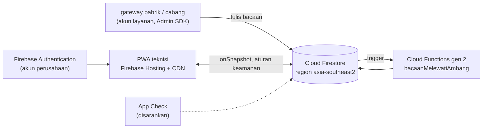

# Pindah ke Firebase (proyek milik klien)

Versi di repo ini diuji dengan emulator. Aplikasi, aturan, indeks, dan Cloud Function dipakai apa adanya; yang
berubah hanya variabel lingkungan dan proyek tujuan. Deploy dilakukan oleh pemilik proyek Firebase.

## Arsitektur di cloud

Penulis data sensor di produksi adalah gateway pabrik dengan **akun layanan** (Admin SDK melewati aturan
keamanan). Simulator tidak dipakai di cloud: ia menolak berjalan tanpa variabel emulator.

## Variabel lingkungan (`.env` dibaca `alat/bangun.mjs`)

| Variabel | Emulator | Cloud |
| --- | --- | --- |
| `FIREBASE_EMULATOR` | `1` | `0` |
| `FIREBASE_PROJECT_ID` | `demo-konsep` (awalan `demo-` = luring) | ID proyek klien |
| `FIREBASE_API_KEY` | `demo-api-key` | kunci Web API proyek (bukan rahasia; aksesnya dijaga aturan) |
| `FIREBASE_AUTH_DOMAIN`, `FIREBASE_APP_ID` | kosong | dari konsol Firebase, Pengaturan proyek |
| `DEMO_SANDI` | sandi akun demo emulator | tidak dipakai (akun demo tidak dibuat di cloud) |

## Langkah deploy

Prasyarat: proyek Firebase klien dengan paket yang mengizinkan Cloud Functions, Firebase CLI 13.35.1, login
`firebase login` oleh pemilik proyek.

1. Isi variabel bagian CLOUD di `.env`, lalu `node alat/bangun.mjs` (membuat `public/` dengan konfigurasi cloud).
2. `firebase use <id-proyek>`.
3. `firebase deploy --only firestore:rules,firestore:indexes` lalu tunggu indeks selesai dibuat.
4. `cd functions && npm install && cd .. && firebase deploy --only functions`.
5. `firebase deploy --only hosting` (predeploy menjalankan `alat/bangun.mjs` lagi).
6. Buat akun teknisi di Authentication dan dokumen `teknisi/{uid}`; daftarkan mesin di koleksi `mesin`.
7. Siapkan gateway penulis bacaan dengan akun layanan berperan minimal (Cloud Datastore User).

## Keamanan

- **Aturan Firestore** (`firestore.rules`): baca hanya untuk yang masuk; aplikasi hanya boleh ambil dan tutup
  tugas; mesin, bacaan, profil hanya server. Jalankan ulang `uji-rules.mjs` di emulator setiap aturan diubah.
- **Authentication**: matikan pendaftaran mandiri; akun dibuat admin. Pertimbangkan SSO perusahaan
  [REAL DATA: penyedia identitas klien].
- **App Check** disarankan agar hanya aplikasi resmi yang bisa memanggil Firestore.
- **Akun layanan gateway**: satu per lokasi, kunci disimpan di gateway, dirotasi berkala.
- **TTL** untuk `bacaan` (lihat docs/DATABASE.md) supaya data lama tidak menumpuk.

## Biaya

Firestore ditagih per baca/tulis/hapus dan penyimpanan; Cloud Functions per pemanggilan dan waktu komputasi;
Hosting per transfer data. Perkiraan bulanan: [REAL DATA: cek harga terbaru di https://firebase.google.com/pricing
dan kalkulator Google Cloud untuk region pilihan]. Besaran untuk kalkulator:

| Besaran | Perkiraan dari desain ini |
| --- | --- |
| Tulis bacaan | jumlah mesin × (86.400 / interval detik) per hari |
| Pemanggilan fungsi | sama dengan jumlah tulis bacaan |
| Baca oleh aplikasi | jumlah teknisi aktif × perubahan tugas (listener hanya membaca dokumen yang berubah) |

Tuas biaya terbesar: interval bacaan. Bila hanya pelanggaran ambang yang penting, gateway cukup mengirim bacaan
tiap menit atau saat nilai berubah berarti.
