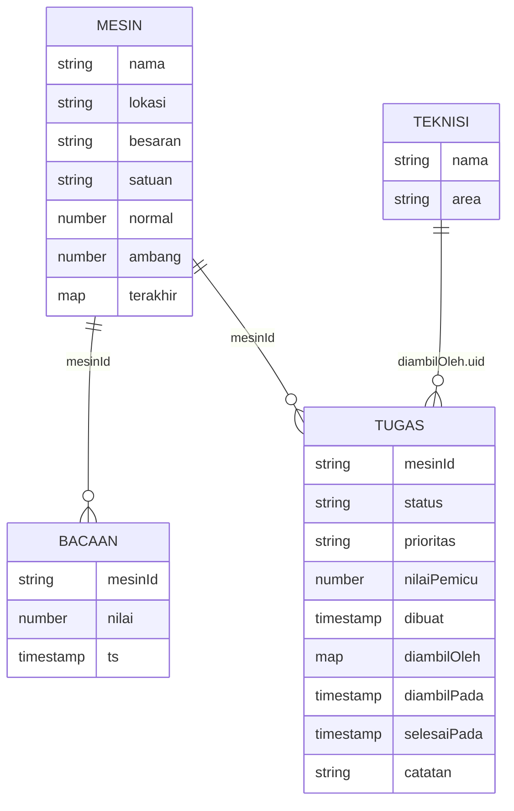

# Model data Firestore

Basis data dokumen tanpa skema. Struktur di bawah adalah kontrak antara simulator/gateway, Cloud Function,
aplikasi, dan `firestore.rules`.

## Koleksi

### `mesin/{id}`

| Field | Jenis | Contoh |
| --- | --- | --- |
| `nama`, `lokasi` | string | "Pompa air pendingin P-01", "Gedung utilitas" |
| `besaran`, `satuan` | string | "Getaran", "mm/s" |
| `normal`, `ambang` | number | 2,4 dan 4,5 |
| `terakhir` | map `{ nilai, ts }` atau null | diperbarui Cloud Function |

### `bacaan/{auto}`

`{ mesinId: "P-01", nilai: 5.6, ts: Timestamp }`. Satu dokumen per pembacaan; ditulis server saja.

### `tugas/{auto}`

| Field | Jenis | Keterangan |
| --- | --- | --- |
| `mesinId`, `mesinNama`, `lokasi`, `besaran`, `satuan`, `ambang` | salinan dari mesin | didenormalisasi supaya daftar tugas cukup satu kueri |
| `nilaiPemicu` | number | bacaan yang memicu tugas |
| `prioritas` | `tinggi` \| `sedang` | |
| `status` | `baru` → `dikerjakan` → `selesai` | transisi dijaga aturan |
| `dibuat` | Timestamp | waktu bacaan pemicu |
| `diambilOleh` | `{ uid, nama }` atau null | tanda tangan "Diambil oleh" |
| `diambilPada`, `selesaiPada` | Timestamp server | `serverTimestamp()` |
| `catatan` | string, maks. 500 | wajib saat menutup (aplikasi minta minimal 5 karakter) |

### `teknisi/{uid}`

`{ nama, area }`. Profil teknisi, dibuat admin. `uid` sama dengan akun Firebase Auth.

## Indeks

`firestore.indexes.json` (ikut ter-deploy):

| Koleksi | Field | Untuk |
| --- | --- | --- |
| `bacaan` | `mesinId` ASC, `ts` ASC | tren sensor per mesin |
| `tugas` | `mesinId` ASC, `status` ASC | cek tugas terbuka di Cloud Function |

Emulator tidak memeriksa indeks; di cloud indeks ini wajib ada sebelum kueri berjalan.

## Volume dan retensi

| Data | Perkiraan |
| --- | --- |
| Bacaan | 8 mesin × 1 per 15 dtk = 46.080 dokumen/hari (emulator). Di produksi tentukan interval [REAL DATA: jumlah mesin dan interval] |
| Tugas | puluhan per hari |

Bacaan perlu dibatasi umurnya: tambahkan field `kedaluwarsa` (mis. `ts` + 30 hari) di setiap bacaan lalu aktifkan **TTL policy** Firestore pada field itu saat
deploy, atau ringkas ke koleksi agregat. Emulator menyimpan data di memori dan dikosongkan simulator setiap start.
