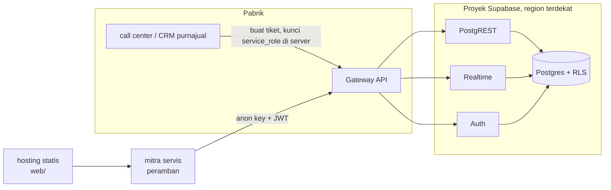

# Cloud · Supabase

Mockup ini diuji dengan **Supabase CLI** (layanan Supabase yang sama, berjalan di Docker lokal). Kode, migrasi,
dan kebijakan RLS dipakai apa adanya di proyek **Supabase cloud** milik klien.

## Arsitektur di cloud



## Langkah deploy ke akun klien

Dilakukan oleh pemilik akun Supabase klien; tim pengembang tidak memegang kredensial akun.

1. Buat proyek di dashboard Supabase. Pilih region terdekat dengan pengguna:
   `[REAL DATA: region yang dipilih klien]`. Simpan sandi database di pengelola rahasia.
2. Hubungkan CLI ke proyek (di mesin admin):
   ```bash
   npx supabase@3.0.0 login
   npx supabase@3.0.0 link --project-ref <ref-proyek>
   ```
3. Terapkan **hanya** migrasi skema. Berkas `*_simulator.sql` dan `seed.sql` berisi data dan akun contoh: hapus
   atau pindahkan berkas simulator dari folder migrasi sebelum push, dan jangan jalankan seed di produksi.
   ```bash
   npx supabase@3.0.0 db push
   ```
4. Di **Authentication > Providers > Email**: matikan pendaftaran mandiri, aktifkan konfirmasi email, dan
   pasang SMTP perusahaan untuk email atur ulang sandi.
5. Buat akun mitra dari dashboard (**Authentication > Users > Invite**), lalu isi tabel `mitra` dan `profil`
   (lewat SQL Editor) untuk menghubungkan akun ke mitra.
6. Isi `web/config.js`: `target: "cloud"`, `url: "https://<ref>.supabase.co"`, `anonKey` dari **Project
   Settings > API**. Kunci `service_role` **tidak pernah** ditaruh di peramban.
7. Sajikan folder `web/` (beserta `shared/`) di hosting statis perusahaan; tambahkan domain itu ke
   **Authentication > URL Configuration** dan sesuaikan `connect-src` pada header CSP.
8. Ganti simulator dengan integrasi nyata: sistem purnajual membuat tiket lewat REST dengan kunci
   `service_role` dari server, atau lewat Edge Function. `[REAL DATA: antarmuka CRM/call center klien]`.

## Variabel lingkungan

| Variabel | Emulator (default) | Cloud |
|---|---|---|
| `web/config.js` `target` | `emulator` (menampilkan akun contoh di layar masuk) | `cloud` |
| `web/config.js` `url` | `http://127.0.0.1:18121` | `https://<ref>.supabase.co` |
| `web/config.js` `anonKey` | kunci demo Supabase CLI | anon key proyek |
| `SIM_DB_URL` | Postgres lokal `:18122` | tidak dipakai (simulator tidak jalan di produksi) |
| `SUPABASE_URL_CLOUD`, `SUPABASE_ANON_KEY_CLOUD`, `SUPABASE_DB_URL_CLOUD` | kosong | catatan nilai cloud untuk admin; jangan di-commit |

## Keamanan

- RLS adalah satu-satunya pembatas data antarmitra; setiap perubahan skema wajib diuji ulang dengan
  `uji-rls.sh` (ganti `API` dan kunci anon ke proyek uji, bukan produksi).
- Jalankan **Security Advisor** di dashboard Supabase setelah migrasi untuk memeriksa tabel tanpa RLS dan
  fungsi `security definer` yang berisiko.
- Batasi akses database langsung (port Postgres) dengan **Network Restrictions** ke IP admin.
- Aktifkan MFA untuk akun admin dashboard Supabase.
- Data pribadi pelanggan tidak disimpan di proyek ini (hanya `pelanggan_ref`); kajian UU PDP tetap diperlukan
  bila kolom ditambah.

## Perkiraan biaya

`[REAL DATA: cek harga terbaru di situs penyedia]` untuk paket proyek, ukuran database, jumlah pengguna aktif
bulanan (Auth), pesan dan koneksi Realtime, serta transfer data. Faktor penentu: jumlah mitra dan teknisi yang
login, jumlah tiket per hari, dan lama retensi.
