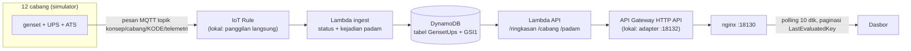

# 13 · Pemantauan Genset & UPS Cabang (AWS)

Pratinjau konsep dasbor untuk klien, ditujukan bagi tim fasilitas pusat: memastikan **12 cabang
tetap menyala saat PLN padam**. Dasbor menampilkan sisa solar genset, baterai dan runtime UPS, kejadian
PLN padam, serta cabang yang paling berisiko mati listrik. Backend Docker adalah demo teknis opsional untuk
menunjukkan arsitektur yang diusulkan, dijalankan sepenuhnya di emulator lokal: tidak memakai akun AWS dan
tidak menimbulkan biaya.

> Kota, kapasitas genset/UPS, dan semua angka adalah **data contoh** dari simulator.

| | |
|---|---|
| Pengguna utama | Tim fasilitas pusat |
| Database | Amazon DynamoDB, desain satu tabel + GSI (di demo: DynamoDB Local 2.6.1) |
| Cara menarik data | REST polling 10 detik lewat API Gateway, paginasi `LastEvaluatedKey` |
| Backend | AWS Lambda Node.js 22 (`ingest` dan `api`), AWS IoT Core + IoT Rule |
| Dasbor | http://localhost:18130 |
| Pratinjau tanpa Docker | `web/index.html?pratinjau` |
| Status | Pratinjau konsep (mockup), bukan sistem produksi. Backend demo diuji 5 November 2026 dengan emulator lokal. |

## Arsitektur



| Komponen | Di emulator (docker compose) | Di AWS (docs/CLOUD.md) |
| --- | --- | --- |
| Penerima telemetri | simulator memanggil handler ingest dengan event berformat IoT Rule | AWS IoT Core + IoT Rule |
| Pemrosesan | `functions/ingest.mjs` (Node.js 22) | AWS Lambda, kode sama |
| Basis data | DynamoDB Local 2.6.1, desain satu tabel + GSI | Amazon DynamoDB on-demand |
| API | `local/adapter.mjs` meniru API Gateway HTTP API v2 → `functions/api.mjs` | API Gateway HTTP API → Lambda, kode sama |
| Dasbor | nginx, proxy `/api` (satu origin) | S3 + CloudFront atau hosting lain |

Daftar cabang dibaca per halaman dengan token `next`, yaitu `LastEvaluatedKey` DynamoDB yang dikodekan
base64url. Detail: [docs/API.md](docs/API.md).

## Menjalankan

### Pratinjau tanpa instalasi

Buka `web/index.html?pratinjau` di peramban, atau galeri semua proyek di `../pratinjau.html`. Dasbor
memakai data contoh bawaan. Tanpa `?pratinjau`, dasbor yang dibuka dari berkas menampilkan pita
"Mode data contoh".

### Demo teknis dengan Docker (opsional)

```bash
cp .env.example .env                 # nilai bawaan sudah untuk emulator
docker compose -p konsep-13 up -d --build
# buka http://localhost:18130  (riwayat 24 jam terisi ±20 detik setelah start)
docker compose -p konsep-13 stop
```

## Konfigurasi

| Port (hanya 127.0.0.1) | Layanan |
| --- | --- |
| 18130 | Dasbor + `/api` |
| 18131 | DynamoDB Local (untuk `aws dynamodb ... --endpoint-url http://localhost:18131`) |
| 18132 | Adaptor API Gateway lokal (langsung, tanpa nginx) |

Kode yang sama dipakai untuk emulator dan AWS; bedanya hanya di `.env`:

| Variabel | Set EMULATOR (bawaan) | Set CLOUD |
| --- | --- | --- |
| `DYNAMODB_ENDPOINT` | `http://dynamodb:8000` | kosong |
| `AWS_REGION` | `ap-southeast-3` | region akun klien |
| `TABLE_NAME` | `GensetUps` | nama tabel di akun klien |
| `AWS_ACCESS_KEY_ID`, `AWS_SECRET_ACCESS_KEY` | `lokal` (DynamoDB Local menerima apa saja; bukan kunci AWS asli) | jangan diisi: kredensial berasal dari peran IAM fungsi Lambda |
| `TICK_DETIK` | `10` | tidak dipakai (data dari IoT Core) |

## Struktur folder

```
app/functions/api.mjs      Lambda HTTP (satu fungsi, rute dari routeKey)
app/functions/ingest.mjs   Lambda ingest dari IoT Rule
app/lib/inti.mjs           klien DynamoDB (emulator/cloud lewat env), aturan status, token halaman
app/local/                 adaptor HTTP, simulator, pendaftaran tabel (khusus emulator)
app/uji.mjs                uji aturan status dan token tanpa database
template.yaml              AWS SAM: tabel, dua fungsi, HTTP API, IoT Rule
web/                       dasbor (HTML/CSS/JS tanpa framework) + nginx.conf
docs/                      API, DATABASE, DAFTAR-TITIK, DESAIN, CLOUD
```

## Keamanan

- Semua port demo hanya terikat ke `127.0.0.1`; dasbor dan API satu origin lewat proxy nginx.
- Parameter divalidasi: `limit`, token `next`, kode cabang, dan `jam` di luar rentang dijawab 400; cabang
  tak dikenal 404.
- nginx menolak metode tulis (`POST /api/padam` → 403).
- Di AWS, kunci akses tidak disimpan di `.env`; Lambda memakai peran IAM (lihat `docs/CLOUD.md`).

## Pengujian dan verifikasi

Verifikasi 5 November 2026 dengan emulator:

| Uji | Hasil |
| --- | --- |
| `node uji.mjs` di container | lulus (aturan status 7 kasus, token halaman, token rusak) |
| Paginasi `GET /api/cabang?limit=5` | 3 halaman, 12 cabang, urut kritis → waspada → normal |
| `GET /api/cabang?status=kritis` | BPN, MKS |
| `GET /api/cabang/PLM/riwayat?jam=24` | 289 titik |
| `GET /api/padam?limit=2` + `next` | MKS, PLM (masih padam), lalu MDN, BPN |
| Validasi | `limit=999`, `next=xx`, `cabang/sb1`, `jam=0` → 400; `cabang/XYZ` → 404; rute asing → 404 |
| Metode tulis lewat nginx | `POST /api/padam` → 403 |
| Dasbor | data API tampil, mode `file://` tampil dengan data contoh |

## Batasan dan langkah berikutnya

Proyek ini adalah pratinjau konsep. Autentikasi, skala, backup, dan pemantauan produksi berada di luar
cakupan pratinjau dan perlu dirancang bila klien memilih proyek ini untuk dilanjutkan. Hal yang perlu
diperhatikan pada tahap itu:

- Login: di AWS, pasang JWT authorizer (lihat `template.yaml` dan `docs/CLOUD.md`); demo tidak memakai
  login.
- DynamoDB Local di demo berjalan `-inMemory`: data hilang saat container berhenti, lalu simulator mengisi
  ulang.
- Ambang status masih contoh dan perlu disepakati dengan tim fasilitas klien (`docs/DAFTAR-TITIK.md`).

## Dokumentasi terkait

- [docs/API.md](docs/API.md): rute API, paginasi `next`, dan contoh jawaban.
- [docs/DATABASE.md](docs/DATABASE.md): desain satu tabel DynamoDB, kunci, GSI, dan TTL.
- [docs/DAFTAR-TITIK.md](docs/DAFTAR-TITIK.md): titik telemetri genset dan UPS beserta ambang status.
- [docs/DESAIN.md](docs/DESAIN.md): arah desain dan token warna serta huruf.
- [docs/CLOUD.md](docs/CLOUD.md): arsitektur di AWS, langkah deploy dengan SAM, keamanan IAM, dan biaya.
