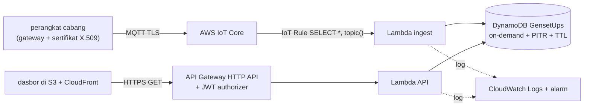

# Pindah ke AWS (akun milik klien)

Versi di repo ini diuji dengan emulator. Kode Lambda (`app/functions`) sama persis; yang berbeda hanya variabel
lingkungan dan infrastruktur yang dibuat oleh `template.yaml` (AWS SAM). Deploy dilakukan oleh pemilik akun.

## Arsitektur di AWS

## Variabel lingkungan

| Variabel | Emulator | AWS |
| --- | --- | --- |
| `DYNAMODB_ENDPOINT` | `http://dynamodb:8000` | **kosong** (SDK memakai endpoint resmi) |
| `AWS_REGION` | `ap-southeast-3` | region pilihan klien, otomatis diisi Lambda |
| `TABLE_NAME` | `GensetUps` | diisi otomatis oleh `template.yaml` |
| `AWS_ACCESS_KEY_ID` / `AWS_SECRET_ACCESS_KEY` | `lokal` (palsu) | **jangan diisi**; Lambda memakai peran IAM |

## Langkah deploy

Prasyarat: akun AWS klien, AWS CLI dan AWS SAM CLI terpasang, login dengan pengguna yang berhak membuat
CloudFormation, Lambda, DynamoDB, API Gateway, dan IoT.

1. `sam build` di folder proyek (membaca `template.yaml`, kode dari `app/`).
2. `sam deploy --guided`, isi parameter `AsalDasbor` dengan alamat dasbor (untuk CORS).
3. Catat keluaran `UrlApi`. Di `web/app.js`, ganti `const API = "/api"` dengan alamat itu, atau tetap pakai `/api`
   bila CloudFront meneruskan `/api/*` ke API Gateway (disarankan, satu origin).
4. Daftarkan cabang: tulis butir `STATUS` awal per cabang (lihat `app/local/cabang.mjs` sebagai contoh format).
   `local/simulator.mjs` menolak berjalan tanpa `DYNAMODB_ENDPOINT`, jadi tidak bisa terpakai ke tabel produksi.
5. Daftarkan perangkat di IoT Core: satu *thing* per cabang, sertifikat X.509, dan kebijakan IoT yang hanya
   mengizinkan `iot:Publish` ke `konsep/cabang/<KODE>/telemetri` miliknya sendiri.
6. Unggah `web/` dan `shared/` ke bucket S3 privat di belakang CloudFront (Origin Access Control).

## Keamanan

- **IAM**: fungsi API hanya `DynamoDBReadPolicy`; fungsi ingest `DynamoDBCrudPolicy` pada satu tabel. Tidak ada
  kunci akses statis di kode atau `.env`.
- **API**: hanya GET. Tambahkan JWT authorizer (Amazon Cognito atau SSO perusahaan) sebelum dipakai di luar uji
  [REAL DATA: penyedia identitas klien].
- **IoT**: satu sertifikat per perangkat, kebijakan per topik, cabut sertifikat bila perangkat hilang.
- **Data**: DynamoDB terenkripsi saat disimpan (bawaan AWS), PITR aktif.

## Biaya

Seluruh komponen berbayar per pemakaian (DynamoDB on-demand, Lambda, API Gateway, IoT Core, CloudWatch).
Perkiraan per bulan: [REAL DATA: cek harga terbaru di https://aws.amazon.com/pricing/ dan AWS Pricing Calculator
untuk region pilihan]. Masukan untuk kalkulator:

| Besaran | Nilai perkiraan dari desain ini |
| --- | --- |
| Pesan IoT | 12 cabang × 1 pesan / 10 detik ≈ 3,1 juta pesan/bulan |
| Penulisan DynamoDB | ±2 per pesan (status + kadang riwayat/kejadian) |
| Pemanggilan API | jumlah layar terbuka × 3 permintaan / 10 detik |
| Penyimpanan | ±30 MB riwayat (TTL 7 hari) |

Interval telemetri adalah tuas biaya terbesar; 60 detik sudah cukup untuk solar dan baterai bila kejadian
(PLN padam/pulih) dikirim seketika.
