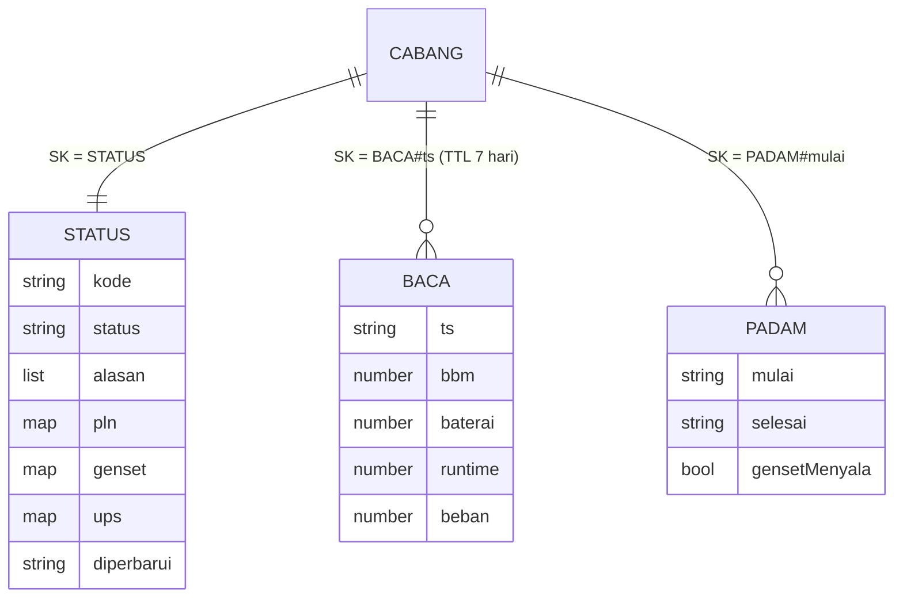

# Basis data: DynamoDB, desain satu tabel

Tabel `GensetUps`, mode kapasitas **on-demand** (PAY_PER_REQUEST). Semua entitas dalam satu tabel. Kunci dibentuk
supaya setiap layar dasbor cukup satu `Query`, tanpa `Scan`.

## Kunci dan indeks

| Atribut | Peran |
| --- | --- |
| `PK` | kunci partisi: `CABANG#<KODE>` |
| `SK` | kunci urut: `STATUS`, `BACA#<ISO waktu>`, atau `PADAM#<ISO mulai>` |
| `GSI1PK` / `GSI1SK` | indeks sekunder global `GSI1` (proyeksi ALL) untuk daftar lintas cabang |
| `kedaluwarsa` | TTL (detik epoch) untuk butir riwayat, 7 hari |

## Entitas

| Entitas | PK | SK | GSI1PK | GSI1SK | Isi utama |
| --- | --- | --- | --- | --- | --- |
| Keadaan cabang | `CABANG#MKS` | `STATUS` | `STATUS` | `<peringkat>#MKS` | identitas, status, alasan, pln, genset, ups, diperbarui |
| Riwayat | `CABANG#MKS` | `BACA#2026-11-05T05:21:41Z` | | | bbm, baterai, runtime, beban, tegangan, frekuensi, status |
| Kejadian padam | `CABANG#MKS` | `PADAM#2026-11-05T05:09:41Z` | `PADAM` | waktu mulai | mulai, selesai, gensetMenyala |

`<peringkat>` = 0 kritis, 1 waspada, 2 normal. Karena itu `Query GSI1PK = STATUS` langsung terurut dari cabang paling
gawat, dan `begins_with(GSI1SK, "0#")` memfilter satu status.

## Pola akses

| Kebutuhan | Operasi |
| --- | --- |
| Daftar cabang terurut status | `Query GSI1 GSI1PK = "STATUS"` (+ `begins_with` untuk filter) |
| Satu cabang | `GetItem PK, SK = "STATUS"` |
| Riwayat N jam | `Query PK = CABANG#X AND SK BETWEEN "BACA#<dari>" AND "BACA#￿"` |
| Kejadian padam terbaru | `Query GSI1 GSI1PK = "PADAM"`, `ScanIndexForward = false` |
| Ingest | `GetItem STATUS` → `UpdateItem STATUS` bersyarat (`diperbarui <= ts`) → `PutItem BACA`/`PADAM` |

## Ukuran perkiraan

Satu butir riwayat ±250 byte. 12 cabang × 1.440 butir/hari × 7 hari ≈ 121 ribu butir ≈ 30 MB. Butir kejadian dan
status dapat diabaikan. Partisi `STATUS` dan `PADAM` di GSI1 kecil (12 butir dan puluhan kejadian per bulan).

## Retensi dan cadangan

- Riwayat: TTL 7 hari lewat atribut `kedaluwarsa`. Simpan agregat jangka panjang di tempat lain bila diperlukan
  [REAL DATA: kebutuhan retensi klien].
- Kejadian padam dan status: tidak kedaluwarsa.
- AWS: Point-in-time recovery aktif di `template.yaml`. Emulator: `-inMemory`, tidak ada cadangan.
