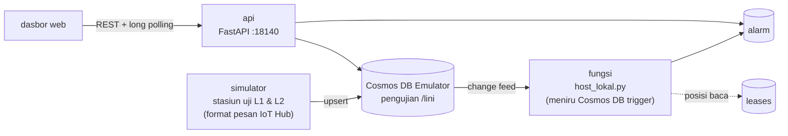

# 14 · Uji Akhir Lini Kulkas (Azure Cosmos DB)

Pratinjau konsep dasbor untuk klien, ditujukan bagi kepala lini: hasil uji akhir setiap unit kulkas
(vakum, kebocoran refrigeran, pendinginan, arus kompresor), first pass yield (FPY) per jam, alasan gagal
terbanyak, dan unit yang menunggu uji ulang. Data disimpan di Azure Cosmos DB; alarm dibuat oleh fungsi
yang membaca change feed. Backend Docker adalah demo teknis opsional untuk menunjukkan arsitektur yang
diusulkan, diuji dengan emulator lokal tanpa akun Azure dan tanpa biaya.

> Semua angka adalah **data contoh** dari simulator. Ambang uji, model kulkas, dan spesifikasi asli ditandai
> `[REAL DATA: ...]`.

| | |
|---|---|
| Pengguna utama | Kepala lini perakitan kulkas |
| Database | Azure Cosmos DB (NoSQL API), container `pengujian` (partisi `/lini`), `alarm`, `leases` |
| Cara menarik data | REST + long polling (`/api/perubahan`); alarm dari change feed |
| Backend | Python: FastAPI (API) + fungsi change feed (Azure Functions Python v2 di cloud) |
| Dasbor | http://localhost:18140 |
| Pratinjau tanpa Docker | `web/index.html?pratinjau` |
| Status | Pratinjau konsep (mockup), bukan sistem produksi. Backend demo diuji 5 November 2026 dengan emulator lokal (Cosmos DB Emulator vnext-preview). |

## Arsitektur



**Fungsi change feed di lokal.** Supaya stack tetap ringan (tanpa Azure Functions Core Tools dan Storage
emulator; menjalankan trigger asli terhadap emulator vnext tidak dicoba), `fungsi/host_lokal.py` menirunya:
membaca change feed per partisi (lini) dengan SDK, menyimpan token lanjutan di container `leases`, lalu
memanggil `fungsi/proses.py`. Di cloud, `fungsi/function_app.py` (Python v2 programming model) memanggil
fungsi yang sama dari trigger asli. Arsitektur Azure lengkap (IoT Hub → Cosmos DB → Functions) ada di
[docs/CLOUD.md](docs/CLOUD.md).

## Menjalankan

### Pratinjau tanpa instalasi

Buka `web/index.html?pratinjau` di peramban, atau galeri semua proyek di `../pratinjau.html`. Dasbor
memakai data contoh bawaan.

### Demo teknis dengan Docker (opsional)

```bash
cp .env.example .env
docker compose -p konsep-14 up -d --build
# tunggu ±1 menit: emulator siap, simulator mengisi riwayat 24 jam (±1.500 dokumen)
# buka http://localhost:18140
docker compose -p konsep-14 stop
```

## Konfigurasi

| Layanan | Image / kode | Port host |
|---|---|---|
| `cosmos` | `mcr.microsoft.com/cosmosdb/linux/azure-cosmos-emulator:vnext-preview` | `127.0.0.1:18141` (gateway), `127.0.0.1:18142` (Data Explorer) |
| `api` | `api/main.py` (FastAPI) + dasbor statis | `18140` |
| `fungsi` | `fungsi/host_lokal.py` | - |
| `simulator` | `simulator/sim.py` | - |

Pilih satu set variabel di `.env`:

| Variabel | Set EMULATOR (bawaan) | Set CLOUD |
|---|---|---|
| `COSMOS_MODE` | `emulator` | `cloud` |
| `COSMOS_ENDPOINT` | `http://cosmos:8081` | `https://<nama-akun>.documents.azure.com:443/` |
| `COSMOS_KEY` | kunci publik bawaan Cosmos DB Emulator (bukan rahasia) | kosongkan untuk memakai managed identity / Microsoft Entra ID (disarankan) |
| `SIM_INTERVAL_S` | `30` | tidak dipakai |

## Struktur folder

```
common/        cosmos.py (koneksi emulator/cloud), aturan.py (ambang uji, FPY, aturan alarm)
db/            containers.json (definisi container: satu sumber)
api/           main.py (REST + long polling, menyajikan web/ dan ../shared)
fungsi/        proses.py (logika), host_lokal.py (lokal), function_app.py (Azure Functions)
simulator/     sim.py (stasiun uji dua lini, backfill 24 jam)
web/           index.html, style.css, app.js (dasbor + data contoh bawaan)
infra/         main.bicep, deploy.sh (deploy ke langganan klien; belum dijalankan)
docs/          API.md, DATABASE.md, DAFTAR-TITIK.md, DESAIN.md, CLOUD.md
uji.py         uji mandiri aturan uji dan alarm
```

## Keamanan

- API hanya baca; metode tulis ditolak (`POST /api/ringkasan` → 405). CORS dibatasi ke origin dasbor.
- Parameter divalidasi: format unit salah → 400, unit tidak ada → 404, `sejak=abc` → 422.
- Port emulator hanya terikat ke `127.0.0.1`. Kunci di `.env.example` adalah kunci publik emulator; untuk
  cloud disarankan managed identity tanpa kunci (lihat `docs/CLOUD.md`).
- Demo tidak memakai autentikasi pengguna dasbor (lihat batasan).

## Pengujian dan verifikasi

Verifikasi 5 November 2026 dengan emulator:

| Uji | Hasil |
|---|---|
| `python uji.py` | `uji lulus` (ambang, FPY, alarm gagal berulang, alarm FPY, batas jendela 20 unit) |
| Emulator vnext-preview + SDK `azure-cosmos` 4.9.0 | database dan 3 container dibuat otomatis, backfill ±1.440 unit + uji ulang |
| Change feed lokal | alarm `gagal_berulang` dan `fpy_rendah` terbentuk; token tersimpan di `leases` |
| `GET /api/health` | `200 {"status":"ok","mode":"emulator"}` |
| `GET /api/ringkasan` | `200`, ±14 kB, ±1 sampai 2,5 dtk (agregasi lintas partisi di emulator) |
| `GET /api/unit/<unit>` / format salah / tidak ada | `200` / `400` / `404` dengan pesan Indonesia |
| `GET /api/perubahan?sejak=<ts>` | kembali saat dokumen baru masuk (6,4 dtk pada uji); `sejak=abc` → `422` |
| `POST /api/ringkasan` | `405` |
| Dasbor mode API (Chrome via CDP) | judul "Lini 2 di bawah target…", status "Tersambung", tanpa galat konsol |
| Dasbor mode file / `?pratinjau` | semua bagian terisi data contoh |
| sloplint | 0 FAIL, 0 WARN |

## Batasan dan langkah berikutnya

Proyek ini adalah pratinjau konsep. Autentikasi, skala, backup, dan pemantauan produksi berada di luar
cakupan pratinjau dan perlu dirancang bila klien memilih proyek ini untuk dilanjutkan. Hal yang perlu
diperhatikan pada tahap itu:

- Autentikasi pengguna dasbor; demo hanya baca dengan CORS terbatas.
- Emulator vnext masih preview: performa kueri lintas partisi tidak mewakili Cosmos DB asli.
- Agregasi 24 jam dihitung di API; lihat `docs/DATABASE.md` untuk jalur peningkatan.
- `infra/` adalah titik awal yang belum pernah dijalankan; nama properti rute IoT Hub ke Cosmos DB perlu
  diverifikasi terhadap versi API saat deploy.

## Dokumentasi terkait

- [docs/API.md](docs/API.md): endpoint REST, long polling, dan alasan pemilihannya.
- [docs/DATABASE.md](docs/DATABASE.md): container Cosmos DB, kunci partisi, change feed, dan agregasi.
- [docs/DAFTAR-TITIK.md](docs/DAFTAR-TITIK.md): parameter uji akhir kulkas beserta ambang.
- [docs/DESAIN.md](docs/DESAIN.md): arah desain dan token warna serta huruf.
- [docs/CLOUD.md](docs/CLOUD.md): arsitektur di Azure, langkah deploy (Bicep), keamanan, dan biaya.
