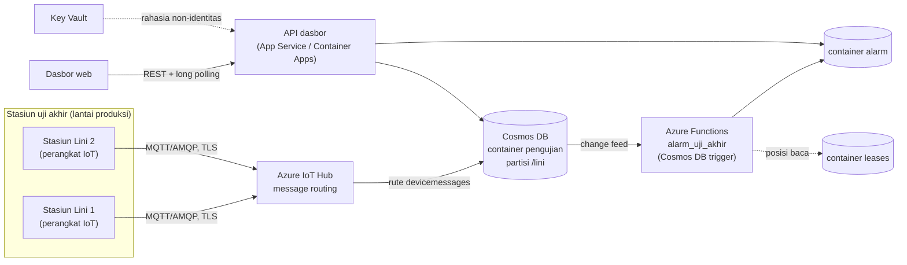

# Menjalankan di Azure asli

Proyek ini dibangun dan diuji dengan **Azure Cosmos DB Emulator** (Linux, Docker) tanpa akun Azure dan tanpa
biaya. Dokumen ini menjelaskan bentuknya di Azure sungguhan dan langkah memindahkannya ke langganan **milik
klien**. Berkas `infra/main.bicep` dan `infra/deploy.sh` disediakan sebagai titik awal dan **belum pernah
dijalankan**; periksa ulang terhadap dokumentasi Azure terbaru sebelum deploy.

## Arsitektur cloud

| Lokal (emulator) | Azure asli |
|---|---|
| `simulator/sim.py` menulis dokumen langsung ke Cosmos | stasiun uji mengirim pesan ke IoT Hub; rute IoT Hub menulis ke container `pengujian` |
| `fungsi/host_lokal.py` membaca change feed per lini, posisi di container `leases` | Function App `alarm_uji_akhir` (`fungsi/function_app.py`) dengan Cosmos DB trigger dan lease container yang sama |
| kunci emulator publik di `.env` | managed identity + peran data Cosmos DB; autentikasi kunci dimatikan (`disableLocalAuth`) |
| API FastAPI di container lokal | API yang sama di Azure Container Apps atau App Service, dengan managed identity |

Logika alarm hanya satu (`fungsi/proses.py` + `common/aturan.py`), dipakai oleh host lokal dan Function App,
jadi perilaku lokal dan cloud sama.

## Variabel lingkungan

| Variabel | Emulator (bawaan) | Cloud |
|---|---|---|
| `COSMOS_MODE` | `emulator` | `cloud` |
| `COSMOS_ENDPOINT` | `http://cosmos:8081` | `https://<akun>.documents.azure.com:443/` |
| `COSMOS_KEY` | kunci emulator publik | kosong, supaya memakai `DefaultAzureCredential` (managed identity) |
| `CosmosDb__accountEndpoint` | tidak dipakai | app setting Function App (koneksi berbasis identitas) |

Kode memilih cara autentikasi di `common/cosmos.py`: bila `COSMOS_MODE=cloud` dan `COSMOS_KEY` kosong, klien
memakai Microsoft Entra ID.

## Langkah deploy (oleh pemilik langganan)

1. Login dengan akun klien: `az login`, lalu pilih langganan: `az account set -s <id-langganan>`.
2. Tinjau `infra/main.bicep` (nama resource, region, SKU IoT Hub, mode serverless Cosmos DB).
3. Jalankan `bash infra/deploy.sh` dari folder proyek. Skrip membuat resource group, Cosmos DB, Key Vault,
   Function App, IoT Hub, peran data, rute pesan, lalu menerbitkan kode fungsi.
4. Daftarkan stasiun uji sebagai perangkat IoT Hub (`az iot hub device-identity create`) dan pasang kredensial
   perangkat di stasiun. Simpan rahasia perangkat di Key Vault, bukan di kode.
5. Deploy API (`api/` + `common/` + `db/` + `web/`) ke Container Apps atau App Service dengan managed identity
   yang diberi peran **Cosmos DB Built-in Data Reader**, lalu set `COSMOS_MODE=cloud` dan `COSMOS_ENDPOINT`.
6. Batasi akses jaringan Cosmos DB (firewall atau private endpoint) sesuai kebijakan TI klien.

## Keamanan

- **Tanpa kunci di cloud.** Cosmos DB memakai `disableLocalAuth: true`; Function App, IoT Hub, dan API mengakses
  data lewat managed identity dengan peran data bawaan (Data Contributor untuk penulis, Data Reader untuk API).
- **Key Vault** untuk rahasia yang tidak bisa memakai identitas (mis. kredensial perangkat), dengan RBAC dan soft delete.
- **API hanya baca.** Dasbor tidak punya endpoint tulis; CORS hanya untuk origin dasbor.
- **Data pribadi**: dokumen uji tidak memuat data pribadi (hanya nomor seri unit dan nilai ukur).

## Biaya

Biaya bergantung pada region, jumlah pesan IoT Hub, RU Cosmos DB, dan eksekusi fungsi.
[REAL DATA: cek harga terbaru di kalkulator harga Azure untuk region dan volume klien]. Sebagai acuan volume:
simulator menghasilkan sekitar 1.440 dokumen uji per hari untuk dua lini (satu unit tiap 2 menit per lini).
