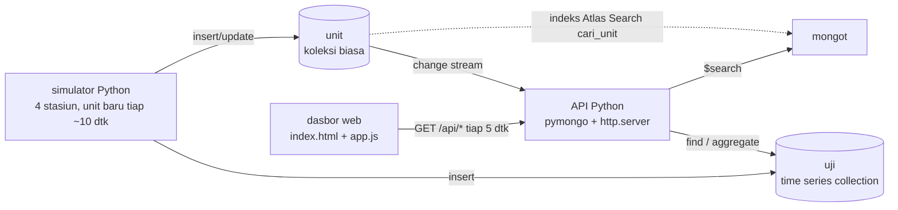

# 15 · Jejak Mutu per Nomor Seri (MongoDB Atlas)

Pratinjau konsep dasbor untuk klien, ditujukan bagi insinyur mutu yang perlu melacak **satu unit
TV atau kulkas** dari lini perakitan sampai kemas, misalnya saat ada keluhan pelanggan. Ketik nomor seri,
kode cacat, atau potongan catatan QC; dasbor menampilkan perjalanan unit melewati empat stasiun beserta
hasil uji, cacat, dan perbaikannya. Backend Docker adalah demo teknis opsional untuk menunjukkan arsitektur
yang diusulkan, memakai image resmi `mongodb/mongodb-atlas-local` (mongod + mongot) sehingga Atlas Search
bisa dijalankan tanpa akun cloud.

> Semua data adalah **data contoh** dari simulator. Model produk, kode cacat, dan teks catatan QC asli:
> `[REAL DATA: dari sistem QC klien]`.

| | |
|---|---|
| Pengguna utama | Insinyur mutu |
| Database | MongoDB Atlas: koleksi `unit` + time series collection `uji`, indeks Atlas Search `cari_unit` |
| Cara menarik data | REST polling 5 detik; pencarian Atlas Search (`$search`); umpan kejadian dari change stream |
| Backend | Python 3.12, pymongo 4.10, `http.server` |
| Dasbor | http://localhost:18150 |
| Pratinjau tanpa Docker | `web/index.html?pratinjau` |
| Status | Pratinjau konsep (mockup), bukan sistem produksi. Backend demo diuji 5 November 2026 dengan emulator lokal (Atlas Local). |

## Arsitektur



Pencarian memakai `$search` dengan `autocomplete` untuk nomor seri dan `text` fuzzy untuk catatan QC. Time
series collection tidak mendukung change stream, karena itu perubahan dibaca dari koleksi `unit` yang
diperbarui setiap kali unit berpindah stasiun. Arsitektur di klaster Atlas asli ada di
[docs/CLOUD.md](docs/CLOUD.md).

## Menjalankan

### Pratinjau tanpa instalasi

Buka `web/index.html?pratinjau` di peramban, atau galeri semua proyek di `../pratinjau.html`. Dasbor
memakai data contoh bawaan.

### Demo teknis dengan Docker (opsional)

```bash
cp .env.example .env          # ganti MONGO_PASSWORD
docker compose -p konsep-15 up -d --build
# buka http://localhost:18150
docker compose -p konsep-15 stop
```

Start pertama: Atlas lokal butuh sekitar 30 sampai 60 detik sampai sehat, lalu simulator mengisi riwayat 7
hari (sekitar 600 unit dan 2.500 uji) dan membuat indeks Atlas Search. Pencarian siap setelah indeks berstatus
`READY` (beberapa detik).

## Konfigurasi

| Komponen | Teknologi | Port (hanya 127.0.0.1) |
|---|---|---|
| Dasbor + API | Python 3.12, pymongo 4.10, `http.server` | 18150 |
| MongoDB Atlas lokal | `mongodb/mongodb-atlas-local:8.0.34` | 18151 |
| Simulator | Python 3.12, pymongo | tanpa port |

| Variabel | Set EMULATOR (bawaan) | Set CLOUD |
|---|---|---|
| `TARGET` | `emulator` | `cloud` |
| `MONGO_USER`, `MONGO_PASSWORD` | `jejak_admin`, ganti sandi lokal | tidak dipakai |
| `MONGODB_URI_CLOUD` | kosong | URI `mongodb+srv://...` klaster Atlas klien |
| `TICK_DETIK` | `6` (jeda antarlangkah lini simulator) | tidak dipakai |

## Struktur folder

```
docker-compose.yml   Atlas lokal + api + simulator
Dockerfile           image Python untuk api dan simulator
api/app.py           REST API, pencarian $search, change stream, penyaji web/ dan ../shared (uji mandiri: app.py uji)
simulator/simulator.py  unit dan uji 4 stasiun, backfill 7 hari, pembuat indeks Atlas Search
web/                 index.html, style.css, app.js
docs/                API, DATABASE, DAFTAR-TITIK, DESAIN, CLOUD
```

## Keamanan

- Kredensial hanya lewat `.env` (diabaikan git). Port database hanya terbuka di `127.0.0.1`.
- API hanya menerima `GET`. Kueri cari divalidasi (2 sampai 60 karakter, tanpa karakter kendali); nomor seri
  divalidasi pola `[A-Z0-9-]{4,24}`; parameter `hari` dibatasi 1 sampai 90.
- Galat database dijawab `503` dengan nama jenis galat saja, tanpa URI atau kredensial.
- Penyajian `/shared/` dicek dengan `realpath` sehingga tidak bisa keluar dari folder `shared`.
- Demo tidak memakai autentikasi pengguna (lihat batasan).

## Pengujian dan verifikasi

Verifikasi 5 November 2026 dengan Atlas Local:

| Uji | Hasil |
|---|---|
| `python api/app.py uji` | lulus (validasi kueri, pipeline cari, garis waktu, pola nomor seri) |
| `GET /api/health` | `200 {"status":"ok","target":"emulator"}` |
| Backfill simulator | 628 unit, 2.565 uji |
| `GET /api/cari?q=garis panel` | unit dengan catatan PNL-02, cuplikan dari `searchHighlights` |
| `GET /api/cari?q=TV43-2611-0004` | 8 nomor seri berawalan itu (autocomplete `lucene.keyword`) |
| `GET /api/cari?q=a`, `/api/unit/..%2Fetc`, `/api/cacat?hari=999` | `400` |
| `GET /shared/../.env` | `404` |
| Indeks `cari_unit` | `READY`, `queryable: true` |
| Dasbor live dan mode `file://` | tampil penuh; sloplint 0 FAIL; kontras teks redup 5,2:1 |

## Batasan dan langkah berikutnya

Proyek ini adalah pratinjau konsep. Autentikasi, skala, backup, dan pemantauan produksi berada di luar
cakupan pratinjau dan perlu dirancang bila klien memilih proyek ini untuk dilanjutkan. Hal yang perlu
diperhatikan pada tahap itu:

- Autentikasi pengguna, mis. di belakang SSO perusahaan.
- Umpan kejadian di demo disimpan di memori proses API (30 terakhir); restart API mengosongkannya lalu
  terisi lagi.
- Waktu antarstasiun di simulator dipercepat (20 detik) supaya perubahan terlihat saat demo; riwayat 7 hari
  memakai jeda 25 sampai 70 menit.
- Backend demo memakai `http.server` pustaka standar; tahap lanjutan sebaiknya memakai server ASGI/WSGI di
  belakang reverse proxy.

## Dokumentasi terkait

- [docs/API.md](docs/API.md): rute REST, parameter, contoh jawaban, dan kode galat.
- [docs/DATABASE.md](docs/DATABASE.md): koleksi, indeks, definisi indeks Atlas Search, dan retensi.
- [docs/DAFTAR-TITIK.md](docs/DAFTAR-TITIK.md): stasiun, besaran uji, dan kode cacat contoh.
- [docs/DESAIN.md](docs/DESAIN.md): arah desain, token, dan keputusan tata letak.
- [docs/CLOUD.md](docs/CLOUD.md): arsitektur di Atlas, langkah deploy, keamanan, dan biaya.
