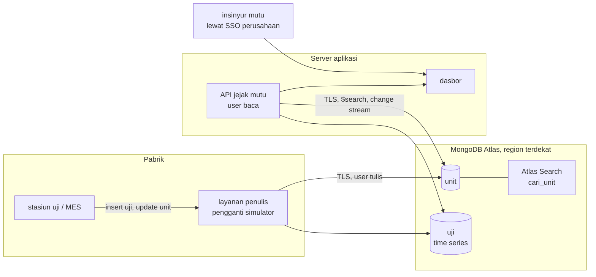

# Cloud · MongoDB Atlas

Mockup ini diuji dengan `mongodb/mongodb-atlas-local` (emulator resmi yang memuat mongod dan mongot). Kode
yang sama berjalan di klaster **MongoDB Atlas** milik klien; yang berubah hanya URI koneksi.

## Arsitektur di cloud



## Langkah deploy ke akun klien

Semua langkah dilakukan oleh pemilik akun Atlas klien; tim pengembang tidak memegang kredensial akun.

1. Buat project dan klaster di Atlas. Tingkat klaster: `[REAL DATA: pilih sesuai volume dan anggaran]`.
   Atlas Search tersedia di klaster Atlas; cek batasan tingkat gratis di dokumentasi Atlas sebelum memilih.
2. **Database Access**: buat dua user.
   - `jejak_tulis`: peran `readWrite` pada database `jejak_mutu` (untuk layanan penulis dari pabrik).
   - `jejak_baca`: peran `read` pada `jejak_mutu` (untuk API dasbor).
   Sandi dibuat acak dan disimpan di pengelola rahasia perusahaan.
3. **Network Access**: izinkan hanya IP keluar server aplikasi dan gateway pabrik. Jangan `0.0.0.0/0`. Untuk
   koneksi privat, pakai Private Endpoint/peering sesuai penyedia cloud klien.
4. Buat koleksi dan indeks: jalankan sekali `python simulator/simulator.py` dengan `TARGET=cloud` lalu hentikan
   setelah log `backfill selesai`, **atau** jalankan hanya fungsi `siapkan()` bila tidak ingin data contoh.
   Indeks Atlas Search `cari_unit` juga bisa dibuat dari UI Atlas dengan JSON di `docs/DATABASE.md`.
5. Isi `.env` di server aplikasi:
   ```
   TARGET=cloud
   MONGODB_URI_CLOUD=mongodb+srv://jejak_baca:<sandi>@<klaster>.mongodb.net/?retryWrites=true&w=majority
   ```
6. Jalankan hanya layanan `api` (layanan `atlas` dan `simulator` tidak dipakai di cloud):
   `docker compose -p konsep-15 up -d --build api`.
7. Ganti simulator dengan integrasi nyata dari MES/stasiun uji: `[REAL DATA: antarmuka sistem MES klien]`.

## Variabel lingkungan

| Variabel | Emulator (default) | Cloud |
|---|---|---|
| `TARGET` | `emulator` | `cloud` |
| `MONGO_USER`, `MONGO_PASSWORD` | user root Atlas lokal | tidak dipakai |
| `MONGODB_URI_EMULATOR` | disusun di `docker-compose.yml` dari dua variabel di atas | tidak dipakai |
| `MONGODB_URI_CLOUD` | kosong | URI `mongodb+srv://` user `jejak_baca` |

## Keamanan

- TLS wajib (bawaan `mongodb+srv://`). Prinsip hak minimum: API hanya peran `read`.
- Daftar IP yang diizinkan sempit; audit log Atlas diaktifkan bila tingkat klaster mendukung.
- Change stream memerlukan peran yang mengizinkan `changeStream` dan `find` pada koleksi `unit`; peran `read`
  bawaan sudah mencakupnya.
- Nomor seri bukan data pribadi; jangan menambahkan data pelanggan (nama, alamat) ke koleksi ini tanpa kajian
  UU PDP.

## Perkiraan biaya

`[REAL DATA: cek harga terbaru di situs penyedia]` untuk tingkat klaster, penyimpanan, transfer data, dan
node Search terpisah (bila dipakai). Faktor yang menentukan: jumlah unit per hari, lama retensi `uji`, jumlah
pengguna dasbor, dan region.
