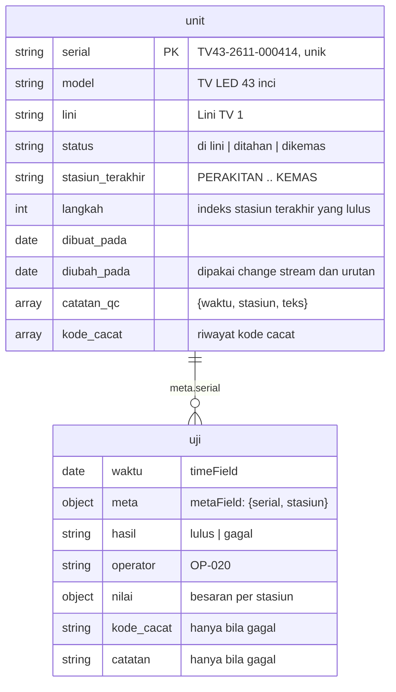

# Database · Jejak Mutu

MongoDB 8.0 (Atlas lokal `mongodb-atlas-local:8.0.34`, atau klaster MongoDB Atlas). Database: `jejak_mutu`.
Koleksi, indeks, dan indeks Atlas Search dibuat otomatis oleh `simulator/simulator.py` (`siapkan()`).

## Model data



### `unit` (koleksi biasa)

Satu dokumen per unit fisik. Diperbarui setiap kali unit diuji, sehingga **change stream** pada koleksi ini
menjadi umpan kejadian. Riwayat cacat disimpan di dalam dokumen (`catatan_qc`, `kode_cacat`) karena jumlahnya
kecil per unit dan selalu dibaca bersama unit; teks catatan juga menjadi bahan Atlas Search.

| Indeks | Kegunaan |
|---|---|
| `serial` unik | buka unit per nomor seri |
| `diubah_pada` turun | sorotan dan isi awal umpan kejadian |
| `status` | hitung unit ditahan / di lini |

### `uji` (time series collection)

```js
db.createCollection("uji", { timeseries: { timeField: "waktu", metaField: "meta", granularity: "minutes" } })
db.uji.createIndex({ "meta.serial": 1, waktu: 1 })
```

Satu dokumen per pengukuran di satu stasiun. Time series dipilih karena data ini append-only, dibaca per
rentang waktu (agregasi cacat 7 hari) dan per unit (`meta.serial`), dan dikompresi per bucket.

Catatan: time series collection **tidak mendukung change stream**, karena itu umpan kejadian dibaca dari `unit`.

## Indeks Atlas Search `cari_unit` (koleksi `unit`)

```json
{
  "mappings": {
    "dynamic": false,
    "fields": {
      "serial": [
        { "type": "string", "analyzer": "lucene.keyword" },
        { "type": "autocomplete", "analyzer": "lucene.keyword", "tokenization": "edgeGram", "minGrams": 2, "maxGrams": 20 }
      ],
      "model": { "type": "string" },
      "kode_cacat": { "type": "string", "analyzer": "lucene.keyword" },
      "catatan_qc": { "type": "document", "fields": { "teks": { "type": "string", "analyzer": "lucene.standard" } } }
    }
  }
}
```

- `serial` memakai `lucene.keyword` pada autocomplete supaya awalan dicocokkan atas string utuh
  (`TV43-2611-0004` → `TV43-2611-000414`), bukan per potongan yang dipisah tanda hubung.
- `catatan_qc.teks` memakai `lucene.standard`. Analyzer bahasa Indonesia bisa dicoba di klaster asli bila
  tersedia: `[REAL DATA: uji analyzer bahasa Indonesia di Atlas]`.
- Simulator memanggil `update_search_index` bila indeks sudah ada, sehingga perubahan definisi ikut terpasang.

## Volume dan retensi

| Data | Volume contoh (simulator) | Retensi |
|---|---|---|
| `unit` | ~90 unit per hari | tanpa batas (jejak garansi) `[REAL DATA: masa garansi produk]` |
| `uji` | ~370 dokumen per hari | contoh: tanpa batas; untuk produksi set `expireAfterSeconds` sesuai kebijakan arsip mutu |

Perkiraan ukuran per unit: dokumen `unit` < 1 KB, 4 sampai 6 dokumen `uji` (dikompresi time series).
Volume nyata bergantung kapasitas lini: `[REAL DATA: unit per hari per lini]`.
