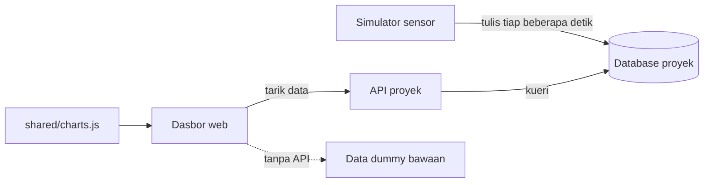

# Arsitektur

Dokumen ini menjelaskan pola yang sama di ke-15 proyek pratinjau dan alasan pilihan teknologinya. Semua proyek
adalah **pratinjau konsep**; arsitektur di sini adalah usulan yang diperagakan dengan data simulator, bukan sistem
yang sudah dirancang untuk produksi.

## Pola umum

Setiap folder `NN-nama/` berisi bagian yang sama:

| Bagian | Isi |
|---|---|
| `web/` | dasbor satu halaman: `index.html`, `style.css`, `app.js` |
| `api/` | backend yang menjembatani dasbor dan database (proyek 09 tanpa kode: PostgREST) |
| `simulator/` | pembangkit data sensor: siklus harian, derau, kejadian alarm sesekali; mengisi riwayat 24 jam saat pertama jalan |
| `db/` | skema, migrasi, dan data awal |
| `docs/` | `API.md`, `DATABASE.md`, `DAFTAR-TITIK.md`, `DESAIN.md`, dan `CLOUD.md` untuk proyek 11 sampai 15 |
| `docker-compose.yml` | database, API, simulator, dan penyaji web untuk demo teknis |

Dasbor selalu bisa dibuka tanpa backend. Bila API tidak menjawab, dasbor memakai data dummy bawaan dan
menampilkan pita penjelasan; dengan `?pratinjau`, pita itu diganti label netral.

## Pustaka bersama `shared/`

| Berkas | Fungsi |
|---|---|
| `charts.js` | grafik garis dan batang SVG dengan tooltip, chip status (ikon + teks), data deterministik, format angka dan waktu Indonesia (`14.32`, `1.234,5`), mode `?pratinjau` |
| `charts.css` | gaya minimum komponen di atas; warna dan huruf diambil dari variabel CSS tiap proyek |
| `BRIEF-AGEN.md` | aturan pembuatan proyek: struktur, port, desain, bahasa, uji |
| `alat/kumpulkan_real_data.py` | menyusun `docs/KEBUTUHAN-DATA-KLIEN.md` |

Grafik dibuat sendiri tanpa pustaka pihak ketiga supaya ke-15 dasbor ringan, tampil sama di mode berkas dan
server, serta mengikuti format angka Indonesia.

## Perbandingan cara menarik data

Tiap proyek sengaja memakai cara berbeda supaya klien bisa membandingkan pilihan untuk kebutuhan yang mirip.

| Cara | Proyek | Cocok untuk | Catatan |
|---|---|---|---|
| WebSocket push | 01 | layar dinding yang harus berubah seketika | koneksi terus terbuka; perlu snapshot REST saat awal |
| REST polling berkala | 02, 13 | data yang berubah tiap beberapa detik | paling sederhana; interval menentukan beban server |
| REST + ETag | 03 | data per 15 menit | jawaban `304` tanpa isi bila tidak ada perubahan, hemat bandwidth |
| GraphQL | 04 | layar yang menggabungkan banyak entitas | satu permintaan untuk daftar mesin, tren, dan spektrum |
| Server-Sent Events | 05 | pembaruan satu arah dari server | lebih ringan dari WebSocket, tersambung ulang otomatis |
| MQTT lewat WebSocket | 06 | peramban berlangganan langsung ke broker IoT | tanpa API perantara untuk data langsung; ACL di broker |
| PromQL HTTP API | 07 | metrik kesehatan perangkat | memakai bahasa kueri Prometheus lewat proxy baca-saja |
| REST + OpenAPI, tugas async | 08 | laporan yang butuh waktu disusun | `202` + polling status, lalu unduh berkas |
| PostgREST | 09, 12 | API otomatis dari skema basis data | tanpa kode backend; keamanan di peran dan view basis data |
| REST + webhook keluar | 10 | kirim data ke sistem eksternal | ditandatangani HMAC, dicoba ulang bila gagal |
| Listener real-time Firestore | 11 | aplikasi HP yang harus jalan offline | SDK menyimpan cache dan menyinkronkan saat online |
| Long polling + change feed | 14 | umpan hasil uji per unit | permintaan menunggu sampai ada dokumen baru |
| REST + Atlas Search | 15 | pencarian teks penuh | indeks pencarian dikelola Atlas |

## Database lokal dan cloud

| Kelompok | Proyek | Dijalankan dengan |
|---|---|---|
| Database yang dipasang sendiri | 01 sampai 10 | image resmi masing-masing di Docker |
| Database cloud | 11 sampai 15 | emulator resmi di Docker (Firebase Emulator Suite, Supabase CLI, DynamoDB Local, Cosmos DB Emulator, Atlas Local) |

Proyek cloud memilih target lewat variabel lingkungan (set `EMULATOR` atau `CLOUD` di `.env`), tanpa cabang kode
terpisah. Langkah memindahkan ke akun cloud milik klien ada di `docs/CLOUD.md` masing-masing; harga layanan
ditulis `[REAL DATA]` karena harus dicek langsung di situs penyedia.

## Keamanan dalam pratinjau

Pratinjau menerapkan dasar berikut supaya demo tidak memberi contoh yang buruk: kredensial lewat `.env` (tidak
masuk repositori), port database hanya di `127.0.0.1`, validasi masukan di API, proxy baca-saja di depan
layanan yang punya endpoint admin, dan Row Level Security atau aturan keamanan di proyek cloud. Autentikasi
pengguna, manajemen rahasia, backup, dan pemantauan produksi berada di luar cakupan pratinjau.

## Desain

Arah visual tiap proyek ditulis dalam lima baris (produk, karakter, dunia, momen, tanda tangan) mengikuti format
[unslop](https://github.com/heydamir/unslop) karya Damir Sokolovsky (CC BY 4.0), digabung dengan panduan desain
internal: latar netral, satu aksen, warna hanya pada bagian yang bermakna, status selalu berupa ikon dan teks.
Rincian per proyek ada di `NN-nama/docs/DESAIN.md`.
